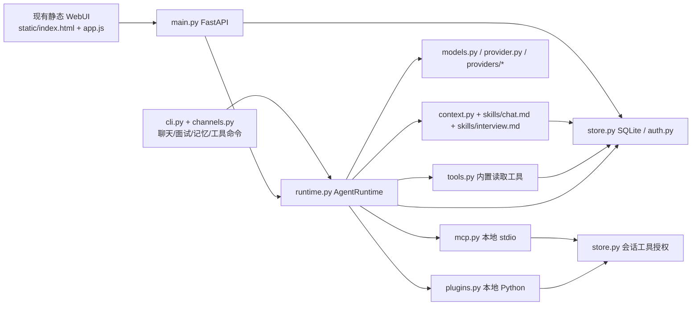

# Nico-agent 后续开发阶段任务文档

> 盘点日期：2026-10-31。依据当前源码和测试阅读；阶段 1–7 已完成本地自动化与本机页面验证，未验证真实商业模型端点。后续完成一阶段时更新状态和验证记录。

## 目标与边界

在本机提供可持续使用的文字求职 Agent：聊天准备与模拟面试各有独立会话，先把后端运行、模型、工具、记忆和终端使用做可靠，再按实际需要接入插件、其他聊天渠道，最后完善已有 WebUI。阶段 1–7 完成基础能力后，主动建设可长期扩展的模块边界、数据迁移机制和性能基线；演进目标及顺序见 [架构演进方案](docs/ARCHITECTURE_EVOLUTION.md)。保留单应用与 SQLite 作为当前运行形态，是否拆进程或更换数据库由性能和可靠性证据决定。**暂缓**公网部署及其安全运营、语音与 OCR、日程和外部搜索的产品功能、真实求职场景验收。模型回答质量和面试效果仍需以后单独评估，不以 demo 输出代替。

本计划中的“完成”指源码中有调用链，并有针对关键行为的测试；README、类型接口或示例单独存在不算完成。以下路径均相对本项目根目录。

## 当前实际调用关系

`main.py` 在请求中选会话所属模型与账户数据库，`runtime.py` 认领运行、构造上下文、调用模型及工具、校验面试 JSON，最后由 `store.py` 按版本提交。`cli.py` 复用同一运行时。`auth.py`、`extract.py`、`auto_backup.py`、`restore.py` 是现有辅助链路，不是新的 Agent 扩展层。

## 进度盘点

| 能力 | 状态 | 可核对的实现与测试 | 边界 |
|---|---|---|---|
| 聊天与面试双线、状态提交、逐题反馈/复练、材料授权 | 已完成基础闭环 | `career_agent/main.py`、`career_agent/store.py`、`career_agent/runtime.py`；`tests/test_api.py`、`tests/test_core.py` | 反馈正确性未作真实模型验收 |
| Agent 工具循环、限额、失败保留输入、版本防迟到提交、在途请求取消 | 已完成基础闭环 | `career_agent/runtime.py`、`career_agent/main.py`、`career_agent/store.py`、`career_agent/events.py`；`tests/test_core.py`、`tests/test_api.py`、`tests/test_provider.py` | 已能取消在本进程、同一事件循环中运行的模型请求；同步插件线程与远端副作用仍不能保证停止 |
| OpenAI Chat Completions、兼容端点、Anthropic、demo 与会话选模型 | 已完成协议适配与本地 HTTP 契约 | `career_agent/provider.py`、`career_agent/models.py`、`career_agent/providers/`；`tests/test_provider.py`、`tests/test_core.py`、`tests/test_model_contracts.py` | 真实端点兼容性与效果未验证；目前是非流式 JSON 请求 |
| 内置只读工具与资源权限 | 已完成 | `career_agent/tools.py`、`career_agent/store.py`；`tests/test_core.py` 中 permission/material/report 用例 | 授权规则主要针对现有读取范围 |
| 本地 stdio MCP、白名单、会话授权、连接复用及失败隔离 | 已完成只读安全闭环 | `career_agent/mcp.py`、`career_agent/runtime.py`、`career_agent/main.py`；`tests/test_mcp.py` | 仅 stdio；非只读工具默认不可授权和调用；工具名有长度与碰撞处理 |
| 本地 Python 插件发现、参数校验、调用 | 已完成可信插件只读基础能力 | `career_agent/plugins.py`、`career_agent/runtime.py`、`examples/echo_plugin.py`；`tests/test_extensions.py` | 只有 `read_only=true` 会提供并执行；超时明确标记后台线程可能仍在运行，插件仍不是沙箱 |
| 短期上下文、固定备注、可回源记忆候选与确认后长期记忆 | 已完成基础能力 | `career_agent/context.py`、`career_agent/store.py`、`career_agent/tools.py`、`career_agent/main.py`；`tests/test_core.py`、`tests/test_api.py`、`tests/test_auth.py` | 候选需用户确认；长期记忆仍为 `LIKE` 字面检索，没有自动确认或向量检索 |
| CLI 聊天、面试闭环、候选记忆、模型与工具授权命令 | 已完成本机入口 | `career_agent/cli.py`、`career_agent/channels.py`；`tests/test_extensions.py` | 账户模式下仍拒绝直连数据库，需使用 Web API |
| WebUI、登录、工具权限、候选记忆与数据备份/恢复 | 已接入当前后端能力 | `career_agent/static/`、`career_agent/main.py`、`career_agent/auth.py`、`career_agent/auto_backup.py`、`career_agent/restore.py`、`career_agent/extract.py`；`tests/test_api.py`、`tests/test_auth.py`、`tests/test_auto_backup.py`、`tests/test_restore.py` | 仅本机使用；不作为公网部署方案 |
| 通用聊天渠道边界 | 已完成本机契约；尚无第二平台适配 | `career_agent/channels.py`、`career_agent/cli.py`；`tests/test_extensions.py` | 已支持发送者/会话绑定、入站去重和同 delivery ID 重试；身份与幂等账本仅限运行进程 |
| 自动写入未经确认的记忆、语义检索、远端 MCP、插件隔离、流式输出 | 尚未实现 | 现有入口见 `career_agent/context.py`、`career_agent/store.py`、`career_agent/mcp.py`、`career_agent/plugins.py`、`career_agent/provider.py`；这些文件没有对应执行路径 | 均不是当前阶段自动承诺的功能；按下方触发条件扩展 |

## 影响后续开发的缺口与风险

**源码已证实：**

1. `career_agent/runtime.py` 已登记当前运行 Task，控制入口会取消本进程中的旧模型请求；`career_agent/providers/transport.py` 的 HTTP 上下文会随 Task 取消关闭。`career_agent/plugins.py` 仍用 `asyncio.to_thread` 调用同步插件，已经进入线程的工作不能保证停止；已发出的 MCP 远端操作也不能保证撤销。
2. `career_agent/store.py:set_tool_grants` 仍只存工具名；当前由 API/CLI 授权检查和 `career_agent/runtime.py` 执行检查共同强制“只有只读工具可用”。增加写工具前必须增加操作等级与确认语义，不能只放宽 `readOnlyHint`。
3. `career_agent/context.py` 仍只取最近 16 条完整消息、可选固定备注和按需工具结果；`career_agent/store.py:search_memories` 是 SQLite `LIKE`。超出窗口的信息现在可经带来源候选转为长期记忆，但不会自动注入上下文，检索同义表述仍无保证。
4. `career_agent/channels.py` 已有发送者、渠道会话、消息 ID、绑定、去重和投递重试边界；当前只有终端适配，绑定与幂等状态仍保存在进程内。接入真实第二渠道前需要确认平台消息 ID 稳定性、身份来源和投递幂等语义。

**需要验证的推测：**真实 OpenAI 兼容服务对工具参数、finish reason、用量字段和超时行为可能有差异；当前单例 MCP 连接在频繁掉线时的恢复可能影响体验；`LIKE` 检索是否足够取决于用户长期记忆规模和查询习惯。先用指定端点的契约测试或使用记录验证，再决定是否扩展协议或检索技术。当前自动化测试结果如下，真实端点效果仍未验证。

## 相关参考源码与取舍

三个参考目录均可访问；以下是本次直接核对的部分，不据此声称看过其全部实现。

| 项目与源码路径 | 源码实际做法 | 本项目取舍 |
|---|---|---|
| Akashic-agent：`E:/Akashic-agent/akashic-agent/agent/looping/session_lane.py`、`agent/tool_runtime.py`、`prompts/agent.py` | 按 session key 串行完整轮次；工具结果带执行状态；提示词区分工具事实与推测 | **调整后采用**工具执行状态和结果提交的可核对记录；现有 SQLite 版本认领已覆盖会话提交，不再叠加整套 lane/调度结构。其大段通用人格提示词**不采用**。 |
| nanobot：`E:/nanobot/nanobot/agent/context.py`、`agent/memory.py`、`templates/agent/skills_section.md`、`templates/memory/MEMORY.md` | 上下文组合历史、记忆与 Skill；记忆有独立存储和整理链路 | **调整后采用**可回源的摘要/记忆设计；保留用户确认边界。文件式自动更新与大量 Skill 注入**不采用**，当前 SQLite 与两份固定 Skill 足够。 |
| nanobot：`E:/nanobot/nanobot/channels/base.py`、`channels/manager.py`、`agent/tools/mcp.py` | 渠道在入站处检查发送者并路由会话；MCP 有多种连接处理 | **调整后采用**身份到会话映射和入站授权先于模型调用；当前本机优先，暂不复制渠道管理器或远端 MCP 全套支持。 |
| Pi-agent/pi：`E:/Agent/Pi-agent/pi/packages/agent/src/agent-loop.ts`、`packages/coding-agent/src/core/system-prompt.ts` | 循环区分中断、截断和工具调用，提示词按可见工具构建 | **采用原则**：截断不能执行工具，提示词与实际可调用工具一致；现有实现已部分具备，后续用测试守住。Pi 的通用编码 Agent 提示词**不采用**。 |
| Pi-agent/pi：`E:/Agent/Pi-agent/pi/packages/coding-agent/src/extensions/mcp/runtime.ts`、`extensions/mcp/tools.ts` | MCP 连接状态/重连及工具命名碰撞有独立处理；副作用调用避免不确定重试 | **调整后采用**故障与工具命名验证；远端 HTTP/OAuth **暂不采用**，无本机需求证据。 |
| nanobot：`E:/nanobot/nanobot/providers/base.py`、`providers/factory.py`、`providers/registry.py` | 统一响应包含内容、工具调用、结束原因、用量和错误元数据；工厂按配置选择协议 | **调整后采用**统一响应与非致命用量缺失语义；当前目录规模不需要照搬厂商注册表和 fallback 链。 |
| Pi-agent/pi：`E:/Agent/Pi-agent/pi/packages/ai/src/types.ts`、`api/anthropic-messages.ts` | 请求支持取消、供应商原生事件与结构化用量；缺失与异常信息保持区分 | **调整后采用**本地 HTTP 契约和“缺失用量不伪造”的规则；完整流式事件、成本估算和大量兼容开关**暂不采用**。 |
| Akashic-agent：`E:/Akashic-agent/akashic-agent/agent/config_models.py`、`agent/config.py` | 配置绑定 provider、model、输出上限和运行时约束 | **调整后采用**会话创建后固定模型 ID，新建会话仍可选择模型；多运行时调度和复杂 profile **不采用**。 |
| Akashic-agent：`E:/Akashic-agent/akashic-agent/agent/tool_hooks/executor.py`、`tool_hooks/base.py` | pre hook 可拒绝或改参，只有通过后才进入真实工具；结果区分 denied、success、error | **调整后采用**“执行前拒绝后才调用工具”的顺序和可记录错误；当前只有每会话只读策略，不引入可插拔 hook 框架。 |
| nanobot：`E:/nanobot/nanobot/agent/tools/mcp.py` | MCP 白名单、工具包装、连接管理与调用错误处理较完整 | **只采用**白名单和失败隔离原则；其工具调用重试**不采用**，因为调用可能已经产生远端副作用。 |
| Pi-agent/pi：`E:/Agent/Pi-agent/pi/packages/coding-agent/src/extensions/mcp/tools.ts`、`extensions/mcp/runtime.ts` | MCP 名称冲突或过长时追加哈希；工具调用避免不确定重试 | **采用**稳定哈希命名和“调用不自动重试”；远端 HTTP/OAuth 仍暂不采用。 |
| nanobot：`E:/nanobot/nanobot/agent/memory.py` 的 `Consolidator.archive` | 按预算把旧消息交给模型摘要并持久化历史，另保留原始会话文件 | **调整后采用**“旧内容压缩成可追溯记录”的流程；自动落为长期事实**不采用**，当前候选必须经用户确认。 |
| Akashic-agent：`E:/Akashic-agent/akashic-agent/core/memory/engine.py`、`core/memory/utils.py`、`core/memory/markdown.py` | 记忆条目保存 `source_ref` 和证据引用，可回源到消息 | **调整后采用**来源消息 ID 与候选审计；向量记忆和复杂记忆引擎**不采用**，SQLite 足够当前规模。 |
| Pi-agent/pi：`E:/Agent/Pi-agent/pi/packages/coding-agent/src/core/compaction/compaction.ts` | 压缩摘要保留来源条目边界，更新摘要时保持此前信息 | **采用原则**只压缩模型视图并保留原始记录；本阶段生成的是用户候选而非自动上下文摘要。 |
| nanobot：`E:/nanobot/nanobot/apps/cli/service.py`、`apps/cli/utils.py` | CLI 服务层复用会话/运行时服务，命令行输出状态化结果 | **调整后采用**薄命令层复用业务服务；当前无需常驻服务进程或完整 TUI。 |
| Akashic-agent：`E:/Akashic-agent/akashic-agent/tests/test_main_lightweight_commands.py` | 管理命令独立分发并验证退出码、帮助和副作用 | **调整后采用**可测试的命令函数、明确退出码和无效状态不写库；不复制其多阶段初始化框架。 |
| Pi-agent/pi：`E:/Agent/Pi-agent/pi/packages/coding-agent/src/cli/args.ts`、`cli/session-picker.ts` | CLI 明确参数、会话恢复与模型选择 | **调整后采用**显式子命令、会话 ID 和模型显示；当前规模不需要交互式 session picker/TUI。 |
| nanobot：`E:/nanobot/nanobot/channels/base.py`、`channels/manager.py` | 渠道入站先校验发送者；发送实现抛错，由管理器统一重试 | **调整后采用**发送者/会话绑定、集中去重和稳定 delivery ID；当前只需单渠道进程，不复制多平台 manager 与配对码体系。 |
| Akashic-agent：`E:/Akashic-agent/akashic-agent/agent/plugins/base.py`、`plugins/manager.py`、`dashboard_host.py` | 插件有显式加载/生命周期和关闭回调 | **调整后采用**“加载时验证、调用异常/超时稳定分类”的最小边界；当前可信单文件插件无需重载和 dashboard 生命周期框架。 |
| Pi-agent/pi：`E:/Agent/Pi-agent/pi/packages/coding-agent/src/core/extensions/loader.ts`、`runner.ts` | 扩展注册、活动状态和工具声明有生命周期约束 | **调整后采用**加载后工具定义不可变的约束；完整扩展热重载、命令/UI 注册**不采用**，当前没有需求。 |
| nanobot：`E:/nanobot/webui/src/components/settings/SettingsView.tsx`、`components/thread/ThreadShell.tsx` | 设置与聊天主界面分离，状态按可用/禁用/错误显示 | **调整后采用**在现有设置弹窗增加候选记忆区和明确禁用态；当前原生页面不引入 React/第三方组件体系。 |
| Akashic-agent：`E:/Akashic-agent/akashic-agent/frontend/chat/src/settings-app.tsx`、`settings.css` | 设置页提供明确分组、内联加载/错误状态和响应式布局 | **调整后采用**分组标题、折叠来源、就地错误和窄屏单列按钮；其 Material/主题体系不采用，项目继续保持黑白灰。 |
| Pi-agent/pi：`E:/Agent/Pi-agent/pi/packages/coding-agent/src/modes/interactive/components/settings-selector.ts` | 设置项展示当前值并区分选择状态 | **调整后采用**权限与记忆状态的明确文字标签；TUI 交互模式不适用于当前 WebUI。 |

## 后续阶段（必须完成）

每阶段先补对应测试，再改最少的现有模块；完成标准均要求在全新临时 `DATA_DIR` 下验证，不对用户业务库运行测试或演示。建议命令中的 `python` 应为项目 Python 3.11+ 环境；命令仅供后续实施，本次没有执行。

### 阶段 1：可靠的单次 Agent 运行（已完成）

- **具体功能**：把中断、超时、重复请求、重试及工具运行后的状态定义成明确契约；在可能的边界主动取消在途模型请求，并确保外部工具结果和最终提交使用同一会话版本。保留目前 4 轮、8 工具、120 秒预算，除非测试证明需调整。
- **实际改动**：`career_agent/runtime.py`、`career_agent/main.py`；`tests/test_core.py`、`tests/test_api.py`、`tests/test_provider.py`。
- **对外结果**：聊天或面试可在失败/中断后安全继续；旧运行绝不覆盖新输入，运行记录能说明停在哪里。
- **完成标准与必要测试**：并发重复运行仅调用一次模型；中断/更正/删除后不提交迟到答复；在模型请求和多工具批次中取消时，无额外未授权调用；失败后重试不重复保存用户消息；事件状态准确。建议 `python -m unittest tests.test_core tests.test_provider -v`，再 `python -m unittest discover -s tests -q`。
- **验证记录（2026-10-31）**：`.venv/Scripts/python.exe -m unittest discover -s tests -v` 运行 111 个测试，全部通过；`compileall` 通过。未启动服务，未验证真实模型端点。
- **依赖/风险**：从现有版本认领机制增量实现。网络请求可取消不等于已发出的远端动作可撤销；同步插件线程可能继续运行，非只读工具仍由阶段 3 约束。

### 阶段 2：多模型可用性验证（本地契约已完成，真实端点待验证）

- **具体功能**：基于已有目录和三个协议适配器，用本地假服务覆盖工具调用、截断、错误、用量及非标准兼容端点的差异；明确每个配置模型是否可用。只为实际选定且不兼容的端点加适配，不预建厂商大全。
- **实际改动**：`career_agent/providers/anthropic.py`；`tests/test_api.py`、`tests/test_model_contracts.py`。无需修改模型目录或新增厂商适配。
- **对外结果**：用户能在新会话选用已验证模型，并得到可诊断的配置/协议错误。
- **完成标准与必要测试**：同一聊天和面试工具循环分别用至少一个受测协议完成；模型选择固定于会话；异常 finish reason 不执行工具；密钥不进入列表或错误信息；不返回用量时标记未知。建议 `python -m unittest tests.test_provider tests.test_core -v`。真实服务的手工连通性需要用户提供端点与密钥，不能以假服务测试宣称已通过真实服务。
- **验证记录（2026-10-31）**：本机 HTTP 假服务已分别完成 OpenAI 兼容聊天和 Anthropic 面试的两轮工具循环；模型 ID 在后续 claim 中保持不变。全套 113 个测试通过。真实端点尚未配置，因此其兼容性和回答质量仍未验证。
- **依赖/风险**：依赖阶段 1 的运行契约。真实端点差异是待验证推测；流式输出仅在实际需要时扩展。

### 阶段 3：外部工具权限与本地 MCP 安全闭环（只读策略已完成）

- **具体功能**：保留已有 stdio 发现、白名单和会话授权；为非只读调用增加本轮可审查确认或默认拒绝的清晰策略，执行前再次核验会话、工具、参数和权限；记录执行结果状态。验证掉线后发现/调用和工具名碰撞。用本地测试 MCP 验证只读调用与写调用被拒；若决定开放写工具，再验证确认后执行。
- **实际改动**：`career_agent/main.py`、`runtime.py`、`mcp.py`、`plugins.py`、`tools.py`、`cli.py`、`README.md`；`tests/test_mcp.py`、`tests/test_extensions.py`。
- **对外结果**：本机用户能看见工具与权限，授予读取；有副作用的工具默认被拒，若开放则只有明确确认后执行。
- **完成标准与必要测试**：未授权工具不可见且不可执行；撤销后的新运行不能使用；写工具不能仅靠 `readOnlyHint=false` 与名称授权自动执行；参数错误和服务器失败不泄露内部内容；断线不重复不确定的副作用调用；超长或碰撞的工具名有确定处理。建议 `python -m unittest tests.test_mcp tests.test_core -v`。
- **验证记录（2026-10-31）**：非只读工具不会提供给模型，API/CLI 不接受其授权，执行层仍返回 `tool_write_disabled`；撤销后新运行不可见；参数错误不会调用 MCP；断线调用只执行一次；跨服务器和插件超长名称使用稳定哈希。全套 119 个测试通过。
- **依赖/风险**：依赖阶段 1；只读安全闭环已完成。**待决**：未来若开放写工具，采用“每次调用确认”还是会话短时授权。

### 阶段 4：可回源的长会话记忆（已完成）

- **具体功能**：保留当前手动长期记忆与聊天/面试隔离。为超出 16 条窗口的聊天内容提供用户可查看、可删改、带来源消息 ID 的摘要或候选记忆；只有用户确认后才作为跨会话长期记忆。检索先继续用 SQLite，确认字面检索不够再换方案。
- **实际改动**：`career_agent/context.py`、`store.py`、`tools.py`、`main.py`、`restore.py`、`skills/chat.md`；`tests/test_core.py`、`test_api.py`、`test_auth.py`、`test_restore.py`。
- **对外结果**：长聊天续谈时能看到经过确认的关键背景；可追溯和纠正过时信息，面试仍不读聊天记忆。
- **完成标准与必要测试**：原始消息不被摘要覆盖；来源和确认状态可查询；删除/更正后旧信息不再进入上下文；预算内优先保留最新消息；不同账户和面试会话隔离。建议 `python -m unittest tests.test_core tests.test_api tests.test_auth -v`。
- **验证记录（2026-10-31）**：候选保存 1–16 条同聊天来源消息且不进入模型上下文；确认前不可被 `search_memories` 检索，确认后才写入 `memories`；支持查看、编辑、删除、备份恢复和账户隔离。删除长期记忆后检索立即失效，原始消息和候选来源不被改写。全套 123 个测试通过。
- **依赖/风险**：依赖阶段 1 的上下文与运行版本契约。自动提炼会误写事实，因此只产生候选，不直接写长期记忆；跨会话检索仍只保证 SQLite `LIKE` 字面匹配。

### 阶段 5：完整本机 CLI（已完成）

- **具体功能**：在现有聊天命令上补齐面试的创建、回答、暂停/继续、报告与复练；显示模型、工具授权与错误状态；保持 CLI 与 API 复用 `AgentRuntime`/`Store`，不要复制一套业务状态机。
- **实际改动**：`career_agent/cli.py`、`channels.py`、`README.md`；`tests/test_extensions.py`。没有复制 Web API 的状态机。
- **对外结果**：无浏览器时可在本机完成一次聊天和 1–10 题面试闭环。
- **完成标准与必要测试**：CLI 恢复会话、失败重试、报告读取与 API 状态一致；无效状态命令不改写数据；账户模式的隔离规则继续生效。建议 `python -m unittest tests.test_extensions tests.test_api -v`；再用临时 `DATA_DIR` 手工走一题 demo 面试。
- **验证记录（2026-10-31）**：聊天支持 `/retry` 复用未回复消息；面试创建、开始、回答、跳题、暂停、恢复、结束、报告和复练均通过共享 Store/Runtime；无效状态不产生新消息；`candidate` 子命令覆盖候选查看、创建、编辑、确认和删除。CLI 输出包含会话状态、模型和工具授权。全套 128 个测试通过。
- **依赖/风险**：依赖阶段 1 的运行契约、阶段 2 的模型配置、阶段 3 的工具授权语义和阶段 4 的候选记忆。账户模式仍要求使用 Web API；真实模型端点未验证。

### 阶段 6：插件与渠道边界（本机契约已完成）

- **具体功能**：在可信本地插件机制上固定生命周期、非只读执行确认、超时后的状态报告；把当前 `TextChannel` 所缺的发送者身份、会话归属和投递结果约束落到一个可复用的入口。使用现有终端入口和测试渠道验证，不预装多平台 SDK。有明确目标渠道时，再接一个实际的本机文字渠道。
- **实际改动**：`career_agent/plugins.py`、`channels.py`、`runtime.py`、`cli.py`、`README.md`；`tests/test_extensions.py`。没有增加平台 SDK。
- **对外结果**：可信插件在授权后可用；终端仍可进入同一后端，新增渠道有明确的身份与会话接入规则。选定目标渠道后可从该渠道使用聊天。
- **完成标准与必要测试**：插件参数、名称冲突、异常、超时有稳定结果；不能把 `to_thread` 超时说成副作用已取消；测试渠道的陌生发送者不能进入已有会话，重复入站不重复运行，投递失败可观察并安全重试。建议 `python -m unittest tests.test_extensions -v` 与新增渠道契约测试，再运行全套测试。实际渠道的端到端验证留给选定渠道后的扩展任务。
- **验证记录（2026-10-31）**：插件异常返回 `plugin_tool_failed`，超时返回 `plugin_timeout` 与 `may_still_be_running=true`；渠道路由拒绝未允许发送者，并阻止其他允许用户接管已绑定会话；同一消息 ID 只运行一次；投递失败后复用同一 delivery ID 重试且不重复运行模型。全套 132 个测试通过。
- **依赖/风险**：依赖阶段 3 的写工具政策与阶段 5 的对话入口。**待决**：第二渠道选哪一种；若没有实际渠道需求，不提前实现平台适配。绑定与幂等状态仅保存在进程内，跨进程去重需平台消息账本或后续持久化；进程隔离只用于不可信插件。

### 阶段 7：现有 WebUI 收尾（已完成）

- **具体功能**：在后端契约稳定后，把阶段 3–6 新增的权限确认、记忆核对、运行/投递状态接入现有页面；核查聊天与面试主要流程、窄屏和键盘操作。只改确实缺失的界面，不重做现有页面。
- **实际改动**：`career_agent/static/index.html`、`app.js`、`style.css`；`tests/test_api.py`、`README.md`、项目定义。无需修改后端 API。
- **对外结果**：本机浏览器可操作新增后端能力，并能看清错误、来源和授权状态。
- **完成标准与必要测试**：新权限不被页面静默授予；摘要来源、确认/删除可见；失败可重试且不会重复提交；关键入口在窄屏和键盘下可用。建议 `python -m unittest tests.test_api -v`、全套测试和本机浏览器手工检查。
- **验证记录（2026-10-31）**：平台设置可读取当前聊天候选、展开来源、编辑保存、确认入库并刷新长期记忆；非只读工具复选框禁用；确认和删除均有明确反馈。桌面和同源 375px iframe 实测无横向溢出，窄屏候选按钮改为单列。Impeccable detector 返回空列表，`node --check` 与全套 133 个测试通过。
- **依赖/风险**：依赖阶段 3、4、6 的对外契约。实际第二渠道未选定，因此只展示“当前仅终端渠道”，未绘制不存在的渠道控制。前端保持既有黑白灰和原生 HTML/CSS/JavaScript 技术栈。

## 下一阶段：可维护架构与升级能力（待实施）

按 [架构演进方案](docs/ARCHITECTURE_EVOLUTION.md) 的 A→B→C→D 顺序实施。首先提取应用服务，让 API、CLI 和未来渠道复用完整业务用例；随后拆持久化职责并建立 schema 前向迁移；再稳固 Agent/工具/模型契约并建立性能基线；选定平台后接入渠道。每步保持现有 API、CLI、数据库行为与账户隔离，完成一组可实际使用并验证的能力后更新本文。建议先运行 `.venv/Scripts/python.exe -m unittest discover -s tests -q` 建立回归基线；性能测试始终使用临时 `DATA_DIR` 和假模型，不使用用户业务库。

## 可后续扩展（有需求再立项）

- 远端 MCP HTTP/OAuth、更多模型厂商、流式 token 展示与精确费用控制：分别由本机 stdio 不够用、指定端点不兼容、实际等待时间/预算需求触发。
- 更强记忆检索、自动提炼与过期策略：由真实检索失败或用户愿意承担确认流程触发。
- 不可信插件的进程隔离、更多聊天渠道：由实际插件来源和使用渠道决定。
- 公网安全运营、密码重置、语音、OCR、日程、外部搜索及场景效果验收：当前明确暂缓，不塞进上述阶段完成标准。

## 可更新任务清单

- [x] 阶段 1：单次运行与中断契约通过测试；记录验证命令/结果。
- [x] 阶段 2：本地模型协议契约通过测试；真实端点尚未另行验证。
- [x] 阶段 3：外部工具只读权限和本地 MCP 安全闭环通过测试；写工具仍关闭。
- [x] 阶段 4：记忆候选可回源、可修改和确认，确认后进入长期记忆且保持账户/面试隔离。
- [x] 阶段 5：CLI 聊天、面试完整闭环和候选记忆管理可用。
- [x] 阶段 6：插件与渠道边界通过本地契约测试；第二文字入口等待明确目标。
- [x] 阶段 7：现有 WebUI 接入工具权限与候选记忆并完成本机桌面/窄屏检查。
- [ ] 架构 A：API、CLI、渠道复用聊天/面试/记忆应用用例，行为回归通过。
- [ ] 架构 B：持久化职责拆分、schema 版本与旧库升级/回滚验证。
- [ ] 架构 C：Agent/工具/模型契约稳固，建立性能基线；按真实端点需求扩展流式。
- [ ] 架构 D：选定第二渠道后持久化绑定和幂等账本；前端按实际新增界面拆分。

## 待用户决定

1. 是否在近期允许 MCP/插件执行写操作；若允许，每次调用确认还是会话短时授权？在此之前按拒绝非只读工具规划。
2. 阶段 2 优先验证哪个真实模型端点？没有端点时先做本地契约测试，真实兼容性保持“未验证”。
3. 第二文字渠道是否已有具体目标？无目标时，阶段 6 先收尾插件边界，不提前实现对应平台。
