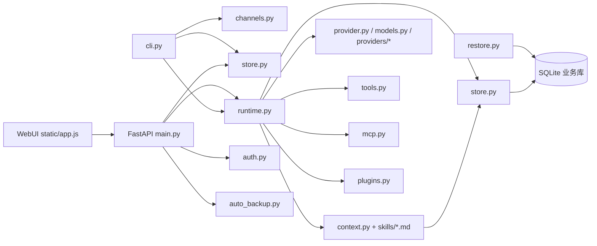

# Nico-agent 最终执行计划

> 文档状态：唯一有效的开发与架构执行计划
> 基线日期：2026-10-31
> 基线提交：`40de88c`（`docs: add staged AI implementation guide`）
> 权威范围：本文合并并取代根目录旧的后续任务计划、开发计划及架构演进文档。实现状态必须根据当前源码、测试和验证记录更新本文，不再另建平行计划。

本次审查开始时仓库位于 `main`，工作区干净；随后只合并了三份旧计划并新增本文，没有修改业务源码、测试或依赖配置。

## 0. 执行原则

1. 开工前完整阅读 `AGENTS.md`、本文、`README.md`、`docs/项目定义.md` 和涉及模块；检查 `git rev-parse --show-toplevel`、`git branch --show-current`、`git status --short --branch` 及最近提交。
2. 直接在当前 `main` 开发，保留无法确认归属的未提交改动；每阶段只提交本阶段涉及的文件，未经明确授权不 push。
3. 以可运行结果和可重复验证作为完成条件。README、类型别名、抽象接口、空目录或“以后会用到”的扩展点不是完成能力。
4. 每阶段只检查三个参考项目中与本阶段直接相关的源码、提示词和工具定义，并记录采用、调整后采用或不采用的理由，不复制大段代码或提示词。
5. 每阶段结束前运行相关测试、全套回归、依赖图检查、受影响 wheel 独立构建和干净环境安装验证。只有实际执行的测试才能标记为通过。
6. 所有测试和性能基准使用临时 `DATA_DIR`、临时 SQLite 文件和假模型。不得对真实用户库执行升级试验。
7. 前端改动前读取仓库 `.qoder/skills/` 的 `ui-ux-pro-max` 与 `impeccable`，保持现有原生 HTML/CSS/JavaScript、键盘/窄屏可用性及黑、白、灰视觉约束。
8. 不为目录规模引入微服务、消息总线、容器编排、向量数据库或通用依赖注入容器。只有测量结果、明确部署边界或安全边界需要时才增加基础设施。

## 1. 项目目标与范围

Nico-agent 是仅在本机运行、可长期扩展的求职 Agent。当前产品包含两条独立业务线：

- 聊天助手：讨论岗位、整理用户确认的经历、解释指定面试反馈、管理经过用户确认的长期记忆。
- 模拟面试：按岗位目标与显式选择的材料逐题提问、保存回答、生成可核验证据的反馈、形成报告并支持单题复练。

工程目标是把现有可运行能力演进为**单仓库、多个独立 Python 发行包、模块化单体**：新增模型、工具、渠道或业务能力时，改动集中在有明确职责的包内；默认仍由一个本机应用进程和现有 SQLite 数据形式运行，各包能够独立构建和测试。

### 1.1 当前必须覆盖

- 可靠的 Agent 循环、取消、失败恢复和运行预算。
- 可替换的多模型适配器和显式模型配置。
- 工具权限、本地 MCP、可信本地插件及统一调用边界。
- 短期上下文、带来源且经用户确认的长期记忆。
- 常驻本机 CLI、HTTP API 与 WebUI。
- 文字渠道边界及跨进程重启后仍成立的入站/投递幂等。
- 版本化 SQLite schema、旧库升级、备份和恢复。
- 可重复的性能基线、依赖图和安装验证。

### 1.2 明确暂缓

- 公网部署、公网账户安全运营、密码重置和互联网访问控制。
- 语音、实时转写、OCR、日程、外部搜索和求职效果量化验收。
- 第二文字平台的具体适配，直至选定平台和测试环境。
- 有副作用工具，直到明确是逐次确认还是会话短时授权。
- 远端 MCP HTTP/OAuth、不可信插件进程隔离、自动记忆写入和语义检索，直至出现真实需求或测量证据。
- 多进程/多机运行、消息总线、独立数据库服务和微服务。启用多进程前必须先解决进程内运行取消和渠道账本语义。

## 2. 当前源码基线

### 2.1 实际调用关系



当前主要事实：

- `career_agent/main.py` 既是 FastAPI 路由层，又负责全局配置、账户 DB 选择、运行协调和入口装配。
- `career_agent/runtime.py` 同时包含通用模型/工具循环、工具审批检查、取消登记和面试输出校验。
- `career_agent/store.py` 同时负责建表/增列、事务、查询、面试状态转换、工具授权、记忆候选和备份。
- `career_agent/cli.py` 直接组装 Store、ModelCatalog、MCP、插件和 Runtime，业务流程与命令解析混在一起。
- `career_agent/context.py` 和两份 Skill 已有真实调用链；`career_agent/tools.py` 定义内置工具与只读工具集合。
- 当前只有一个根 `pyproject.toml`，包发布名是 `nico-agent`，实际 Python 包是 `career_agent`。

### 2.2 能力盘点

| 能力 | 状态 | 可核对证据 | 尚缺部分 |
|---|---|---|---|
| 聊天与面试双线、材料/经历确认、逐题反馈、报告与复练 | 已完成本机基础闭环 | `career_agent/main.py`、`career_agent/store.py`、`career_agent/runtime.py`、`tests/test_api.py`、`tests/test_core.py` | 真实模型效果未验收；业务规则仍分散在入口、Store 和 Runtime |
| Agent 工具循环、取消、会话版本防迟到提交、上下文与调用限额 | 已完成基础能力，通用边界未建立 | `career_agent/runtime.py`、`career_agent/events.py`、`career_agent/context.py`、`tests/test_core.py`、`tests/test_provider.py` | Runtime 耦合面试协议；`_ACTIVE_RUNS` 仅进程内；同步插件线程不可可靠取消 |
| OpenAI Chat Completions、OpenAI 兼容端点、Anthropic、demo 与会话模型选择 | 已完成本地协议适配；本地真实端点验收路径已定，商业服务待选 | `career_agent/provider.py`、`career_agent/models.py`、`career_agent/providers/`、`tests/test_provider.py`、`tests/test_model_contracts.py` | 先用本地 OpenAI 兼容端点验证工具调用；商业端点尚未验收；非流式；HTTP 客户端尚未在长生命周期内复用 |
| 内置只读工具、会话授权与只读并行 | 已完成当前只读安全闭环 | `career_agent/tools.py`、`career_agent/runtime.py`、`career_agent/store.py`、`tests/test_core.py` | 没有通用工具目录快照和独立权限策略包；写工具未开放 |
| 本地 stdio MCP、白名单、连接复用、失败隔离 | 已完成只读基础能力 | `career_agent/mcp.py`、`career_agent/runtime.py`、`tests/test_mcp.py` | 仅 stdio；无远端 MCP；不确定副作用调用不重试的规则需继续由契约测试守住 |
| 短期上下文、固定备注、可回源候选和确认后长期记忆 | 已完成基础能力 | `career_agent/context.py`、`career_agent/store.py`、`career_agent/tools.py`、`career_agent/skills/chat.md`、`tests/test_core.py`、`tests/test_api.py` | 固定 16 条消息窗口；长期记忆为 SQLite 字面检索；无自动注入或自动确认 |
| 可信本地 Python 插件发现、授权、参数校验和调用 | 已完成当前只读基础能力 | `career_agent/plugins.py`、`examples/echo_plugin.py`、`tests/test_extensions.py` | 无显式生命周期/关闭接口；超时线程可能继续；无可信来源隔离 |
| CLI 聊天、面试、候选记忆、模型和工具命令 | 已完成本机基础能力 | `career_agent/cli.py`、`career_agent/channels.py`、`tests/test_extensions.py` | 账户模式拒绝 CLI；命令层直接装配具体实现；未拆发行包 |
| WebUI、登录、工具权限、候选记忆、导出与备份 | 已完成本机基础能力 | `career_agent/static/`、`career_agent/main.py`、`career_agent/auth.py`、`tests/test_api.py`、`tests/test_auth.py`、`tests/test_auto_backup.py` | `static/app.js` 集中大量页面状态；静态资源仍依赖包内文件系统路径 |
| SQLite 业务数据、账户隔离、备份恢复 | 已完成基础能力 | `career_agent/store.py`、`career_agent/auth.py`、`career_agent/auto_backup.py`、`career_agent/restore.py`、`tests/test_restore.py` | 无显式 schema 版本；建表/ALTER 位于 `Store` 初始化；恢复表清单需随迁移演进 |
| 文字渠道身份、去重和投递重试契约 | 部分完成 | `career_agent/channels.py`、`tests/test_extensions.py` | 只有 ConsoleChannel；绑定和幂等账本仅内存；无第二平台 |
| 运行事件与用量记录 | 部分完成 | `career_agent/events.py`、`career_agent/runtime.py`、`tests/test_core.py` | 没有稳定事件端口；Web 无流式事件；无性能指标输出 |
| 单仓库多发行包、独立 wheel、包依赖检查 | 尚未实现 | 当前仅有根 `pyproject.toml`；`[tool.setuptools] packages` 明确列出 `career_agent` 和 `career_agent.providers` | 所有目标包、发布依赖和独立安装验证均未建立 |
| 性能基准与容量证据 | 尚未实现 | 仅有运行/上下文/事件上限：`career_agent/runtime.py`、`career_agent/context.py`、`career_agent/events.py` | 无查询延迟、并发、锁等待、内存、HTTP 连接复用或备份基准 |

仓库旧文档记录了截至 2026-10-31 的 133 个测试通过及若干本机页面检查，但本次文档合并没有重新运行业务测试，因此这些结果只作为历史记录，不宣称为当前提交的新验证。

### 2.3 必须保持的兼容基线

- HTTP 路由、状态码和错误码，包括聊天、面试、材料、经历、记忆、工具、备份和认证 API。
- CLI 命令 `chat`、`models`、`memory`、`candidate`、`interview`、`tools` 及 `python -m career_agent`、`python -m career_agent.cli`、`python -m career_agent.restore`。
- 现有公开导入路径，迁移期至少包括 `career_agent.main`、`career_agent.cli`、`career_agent.store`、`career_agent.runtime`、`career_agent.provider`、`career_agent.models` 及测试使用的其他符号。
- `DATA_DIR` 显式指定时必须精确使用原目录；源码/editable 启动的默认 `data/` 目录保持不变，单用户库 `career_agent.sqlite3`、认证库 `auth.sqlite3`、账户业务库 `users/<用户ID>/career_agent.sqlite3` 的语义不变。安装后的 wheel 在 Windows 默认使用 `%LOCALAPPDATA%\Nico-agent`；不能静默换库。
- 会话、消息、材料、经历、候选记忆、运行事件等数据库 ID、创建时间、状态值和外键关系。
- 账户隔离、登录限流、提交前数据快照、原子替换恢复、每日/最新自动备份。
- 聊天与面试分离、面试不读取聊天消息或聊天记忆、只读外部工具默认策略。

## 3. 已证实的缺口、耦合与风险

### 3.1 源码已证实

1. **导入有副作用，装配不可替换。** `career_agent/main.py:26` 至 `career_agent/main.py:35` 在模块导入时读取环境、创建 Store/Provider/ModelCatalog/MCP/Plugin/Runtime；Web、测试和 CLI 难以使用不同组合根。
2. **入口同时承担应用用例。** `career_agent/main.py` 的 740 行代码包含中间件、请求模型、路由、运行状态协调和导出流程；`career_agent/cli.py` 另行复述部分面试流程，入口层无法完全共享用例。
3. **Agent 内核知道面试业务。** `career_agent/runtime.py` 的 `run` 解析面试 JSON、检查题号阶段和回答证据，并直接调用 Store 提交。通用循环与求职领域规则未分离。
4. **持久化边界过宽。** `career_agent/store.py` 在构造时建表并逐列 ALTER，同时承担全部查询和状态转换；没有 schema 版本和迁移账本。
5. **认证请求重复初始化存储。** `career_agent/main.py:84` 到 `career_agent/main.py:88` 每个认证请求创建账户 Store 和 Runtime，而 Store 构造会执行建表/ALTER 检查。其实际延迟尚无基准，属于已证实的结构热点，性能影响仍需测量。
6. **同步 SQLite 与异步运行交错。** Store 方法在协程路径中同步打开新连接；每方法一次连接简化了事务，但可能阻塞事件循环并放大锁等待。影响程度需基准验证。
7. **模型 HTTP 客户端未复用。** `career_agent/providers/transport.py:10` 每次模型请求创建新 `httpx.AsyncClient`，每次工具循环中的模型轮次都会重新建立连接池。是否构成主要延迟需以选定真实端点测量。
8. **取消和渠道账本只在当前进程。** `career_agent/runtime.py` 的 `_ACTIVE_RUNS` 与 `career_agent/channels.py` 的 bindings/events 都是进程内存；多 worker 或重启后语义失效。
9. **插件超时不等于副作用停止。** `career_agent/plugins.py` 通过 `asyncio.to_thread` 执行同步插件；超时只停止等待，线程可能继续。当前 README 和测试明确保留该语义。
10. **会话搜索可能随数据量退化。** `career_agent/store.py` 的 `list_sessions` 对消息正文执行相关子查询式 `LIKE`/`instr`，且列表无分页；大数据量影响尚未测量。
11. **部分兼容端点的思考模式需要额外协议字段。** 当前 `career_agent/runtime.py:189` 的 assistant 工具消息只保留 `role/content/tool_calls`。选择真实商业端点时，须先确认其带工具的后续请求要求；供应商字段留在适配器，不写入 Agent 循环。
12. **包资源依赖文件位置。** `career_agent/context.py:11`、`career_agent/main.py` 末尾静态目录以及迁移前尚无的迁移文件都通过 `Path` 定位包内资源；迁移时需改为 `importlib.resources`，避免 wheel/zip 安装和工作目录差异。
13. **发布单位单一且易漂移。** 根 `pyproject.toml` 显式列出包，`nico_agent.egg-info/SOURCES.txt` 已出现与当前文件树不一致的旧条目；该目录被忽略，但说明 editable 元数据不能作为发布完整性证据。

### 3.2 需要测量验证，不得先下结论

- 新 SQLite 连接、PRAGMA/DDL 检查在认证请求中的真实开销。
- 1,000 或 10,000 条消息时会话搜索、列表返回和上下文准备是否超过本机交互预算。
- 复用 `httpx.AsyncClient`、连接池或 keep-alive 对指定真实端点的收益。
- WAL、缓存、批量查询或数据库更换是否必要；当前没有指标证明应直接采用。
- 同步插件超时、MCP 并发和渠道账本持久化带来的锁竞争。

## 4. 参考项目结论

以下均来自可访问的本地源码；只采用与当前缺口直接相关的结构，不复制大段实现或提示词。

| 项目与源码 | 源码实际做法 | 对 Nico-agent 的决定 |
|---|---|---|
| Pi：`E:/Agent/Pi-agent/pi/package.json`、`E:/Agent/Pi-agent/pi/packages/agent/package.json`、`E:/Agent/Pi-agent/pi/packages/coding-agent/package.json` | 根工作区下的包各自声明依赖和发布入口，Agent 核心与具体编码 Agent 分层 | **调整后采用**单仓库多 Python 发行包和显式依赖；不照搬 npm/pnpm 工具链或包数量 |
| Pi：`E:/Agent/Pi-agent/pi/packages/agent/src/agent-loop.ts`、`E:/Agent/Pi-agent/pi/packages/agent/src/types.ts` | `agentLoop` 只处理消息、工具结果、停止原因、取消和事件；业务通过 hooks/context 接入 | **采用**通用循环与求职业务分离；只保留当前需要的预算、取消和终止规则，不复制完整编码 Agent 功能 |
| Pi：`E:/Agent/Pi-agent/pi/packages/coding-agent/src/core/system-prompt.ts` | 系统提示分节，并根据实际可用/隐藏工具生成提示 | **调整后采用**同一工具授权快照同时决定提示和可执行集合；保留 Nico 的两份短提示，不引入大规模动态提示系统 |
| Pi：`E:/Agent/Pi-agent/pi/packages/coding-agent/src/extensions/mcp/runtime.ts`、`E:/Agent/Pi-agent/pi/packages/coding-agent/src/extensions/mcp/tools.ts` | MCP 连接状态独立；只读发现可有限重试，工具调用本身不会因不确定副作用自动重试 | **采用**连接/发现与工具调用分层、稳定工具名和不重试不确定副作用；远端 MCP/OAuth 列为条件任务 |
| Pi：`E:/Agent/Pi-agent/pi/packages/coding-agent/src/core/session-manager.ts` | 会话格式有显式 `CURRENT_SESSION_VERSION` 和顺序迁移函数 | **采用**显式版本和前向迁移原则；Nico 使用 SQLite schema 版本，不复制其 JSONL 会话格式 |
| Pi：`E:/Agent/Pi-agent/pi/packages/coding-agent/src/core/extensions/loader.ts` | 扩展加载有安装/加载/验证/活动状态及运行上下文 | **调整后采用**可信插件的 load/prepare/activate/retire/close 最小生命周期；不复制其命令、UI、热重载和插件生态框架 |
| nanobot：`E:/nanobot/nanobot/agent/loop.py`、`E:/nanobot/nanobot/agent/runner.py` | TurnState/Loop 负责产品轮次，AgentRunner 明确声明“without product-layer concerns” | **采用**运行器与求职工作流分离；Nico 不需要 nanobot 的复制定时任务、子 Agent 和命令系统 |
| nanobot：`E:/nanobot/nanobot/agent/context.py`、`E:/nanobot/nanobot/templates/agent/tool_contract.md` | 上下文在运行前组装，工具契约从模板资源注入 | **采用**提示词/工具规则集中且可追踪；不复制其完整身份、记忆、Skills 注入文本 |
| nanobot：`E:/nanobot/nanobot/agent/tools/registry.py` | 工具注册、定义缓存、参数准备、校验和统一执行入口分离 | **调整后采用**统一工具目录和参数校验，增加 Nico 的逐会话授权快照；不引入运行时全局 mutable registry |
| nanobot：`E:/nanobot/nanobot/agent/tools/mcp.py` | MCP 支持多传输、连接栈和重连；工具调用存在有限重试 | **只采用**接口分层、服务器隔离和用户可见状态；工具调用自动重试不采用，避免重复副作用 |
| nanobot：`E:/nanobot/nanobot/channels/base.py`、`E:/nanobot/nanobot/channels/manager.py` | 渠道实现 start/stop/send，管理器统一启停、路由和发送策略 | **调整后采用**显式渠道生命周期和统一错误上抛；Nico 当前不复制消息总线、配对系统和多平台管理器 |
| nanobot：`E:/nanobot/nanobot/providers/base.py` | 统一响应包含工具调用、结束原因、用量及结构化错误；流式与重试分离 | **调整后采用**稳定响应/错误模型和“缺失用量不伪造”；当前只实现已存在三协议与有限 429/503 重试，不复制多模式无限重试 |
| Akashic-agent：`E:/Akashic-agent/akashic-agent/bootstrap/app.py`、`E:/Akashic-agent/akashic-agent/bootstrap/tools.py`、`E:/Akashic-agent/akashic-agent/bootstrap/providers.py`、`E:/Akashic-agent/akashic-agent/bootstrap/wiring.py` | `bootstrap` 集中装配 provider、toolset、memory、channel 和运行时 | **调整后采用**独立组合根和构造注入；不复制其后台任务、主动执行和多宿主服务 |
| Akashic-agent：`E:/Akashic-agent/akashic-agent/agent/looping/core.py`、`E:/Akashic-agent/akashic-agent/agent/looping/session_lane.py` | 同一 session 的完整轮次串行，无关 session 可并发 | **调整后采用**会话级串行/版本认领思想；保留 Nico 的 SQLite 版本机制，不额外引入完整 lane 调度器 |
| Akashic-agent：`E:/Akashic-agent/akashic-agent/agent/tool_hooks/executor.py` | 执行前 hook 可拒绝、改参；调用后才进入工具；结果区分 denied/error/success | **调整后采用** “授权/最终参数确定后才调用”的顺序和结果分类；不预建通用 hook 平台 |
| Akashic-agent：`E:/Akashic-agent/akashic-agent/agent/migrations/runner.py` | 启动前在 workspace 锁下应用 Yoyo 迁移并记录已应用集合 | **只采用**启动前串行迁移、失败中止和迁移记录；当前规模用标准库 SQLite 顺序迁移，不增加 Yoyo 依赖 |
| Akashic-agent：`E:/Akashic-agent/akashic-agent/core/memory/engine.py` | 记忆记录携带 `EvidenceRef` 和来源 resolver | **采用**长期记忆必须可回源；不采用复杂多引擎、图谱和自动记忆写入 |
| Akashic-agent：`E:/Akashic-agent/akashic-agent/agent/plugins/base.py` | 插件声明版本并暴露 prepare/activate/retire/terminate 生命周期 | **调整后采用**最小生命周期和不可变工具目录；不可信插件进程隔离仅在真实来源出现后实施 |
| Akashic-agent：`E:/Akashic-agent/akashic-agent/prompts/agent.py`、`E:/Akashic-agent/akashic-agent/agent/context.py` | 身份、行为、记忆和上下文按块组织，并保留可追踪的组装边界 | **不采用**其完整人格/主动任务提示体系；Nico 继续使用求职专用短提示和结构化状态 |
| Akashic-agent：`E:/Akashic-agent/akashic-agent/agent/tools/registry.py`、`agent/tool_hooks/executor.py`、`prompts/agent.py` | Registry 统一登记工具风险、来源和声明；执行器先允许拒绝/确定最终参数，再调用实现，提示词只要求调用当前可见工具 | **调整后采用**同一会话授权快照生成模型声明与执行映射，并在调用前校验；不复制动态搜索、hook 平台或其完整提示词 |
| nanobot：`E:/nanobot/nanobot/agent/tools/registry.py`、`agent/tools/base.py`、`agent/runner.py`、`templates/agent/tool_contract.md` | Registry 提供稳定工具声明、参数准备/校验和统一执行入口；Runner 承担调用批次，契约提示说明读写及验证顺序 | **调整后采用**通用 adapter 端口、目录快照和同一执行边界；保留 Nico 严格 JSON Schema 拒绝行为，不采用错误后自动换法重试的提示 |
| Pi：`E:/Agent/Pi-agent/pi/packages/agent/src/agent-loop.ts`、`packages/coding-agent/src/core/system-prompt.ts`、`packages/coding-agent/src/core/mcp-servers.ts`、`packages/coding-agent/src/extensions/mcp/runtime.ts`、`packages/coding-agent/src/core/extensions/loader.ts` | Agent loop 在工具列表中校验后执行；提示声明按选中工具生成；MCP server 注册副本隔离，关闭可取消连接；扩展加载失败会丢弃本次注册 | **调整后采用**目录与执行使用同一只读快照、资源释放和最小插件生命周期；本阶段只保留本地 stdio，不引入远端 MCP/OAuth、热重载或完整扩展框架 |

## 5. 目标架构

### 5.1 总体结构

最终仓库采用单仓库、九个独立 Python 发行包。根目录只承载工作区开发配置、跨包集成测试、基准与发布脚本；每个 `packages/<name>/pyproject.toml` 是独立构建输入端。

```text
Nico-agent/
├─ pyproject.toml                 # 工作区/开发工具配置，不发布业务 wheel
├─ README.md
├─ AGENTS.md
├─ EXECUTION_PLAN.md
├─ docs/
│  └─ 项目定义.md
├─ packages/
│  ├─ nico-contracts/
│  │  ├─ pyproject.toml
│  │  ├─ src/nico_contracts/
│  │  └─ tests/
│  ├─ nico-domain/
│  ├─ nico-agent-core/
│  ├─ nico-application/
│  ├─ nico-adapters/
│  ├─ nico-storage/
│  ├─ nico-cli/
│  ├─ nico-web/
│  └─ nico-app/
├─ tests/                          # 跨包 API/CLI/安装/兼容测试
├─ scripts/                        # 依赖图、构建、安装和基准脚本
└─ benchmarks/                     # 固定数据生成与结果模板
```

### 5.2 包职责和依赖

下表箭头含义是“允许导入”。任何未列出的包间导入都视为架构失败。

| 发行包 / 导入包 | 职责 | 允许依赖的仓库内包 | 禁止事项 |
|---|---|---|---|
| `nico-contracts` / `nico_contracts` | 跨边界稳定协议和数据类型：消息、工具调用/声明、模型响应、用量、运行事件、渠道消息、错误分类、取消标记 | 无 | 禁止导入任何其他仓库内包；禁止 FastAPI、SQLite、argparse 和厂商 SDK |
| `nico-domain` / `nico_domain` | 求职领域值对象与规则：会话状态转换、面试题/证据规则、材料/经历确认、记忆候选规则 | 无 | 禁止框架、SQLite、文件系统、模型/平台 SDK；不得直接产生业务副作用 |
| `nico-agent-core` / `nico_agent_core` | 通用 Agent 循环、上下文预算执行、工具批次、模型端口、运行事件、取消/终止 | `nico-contracts` | 禁止知道 chat/interview 数据结构；禁止导入 `nico-application`、适配器、存储或入口 |
| `nico-application` / `nico_application` | 聊天、面试、材料、记忆、工具授权、渠道处理用例；定义仓储、UoW、工具、提示资源和运行端口 | `nico-contracts`、`nico-domain` | 禁止 FastAPI、argparse、SQLite、具体模型/MCP/渠道 SDK；禁止导入 core、适配器、存储、CLI、Web、App |
| `nico-adapters` / `nico_adapters` | 具体模型协议/HTTP、MCP、可信插件、渠道传输、材料文本提取；实现 application/core 端口 | `nico-contracts`、`nico-domain`、`nico-agent-core`、`nico-application` | 禁止导入 `nico-storage`、`nico-cli`、`nico-web`、`nico-app`；不得拥有业务状态转换所有权 |
| `nico-storage` / `nico_storage` | SQLite UoW/仓储实现、账户认证、schema 迁移、备份恢复、持久渠道账本；实现 application 端口 | `nico-contracts`、`nico-domain`、`nico-application` | 禁止 FastAPI、argparse、模型/平台 SDK、CLI/Web/App；不得导入 `nico-adapters` |
| `nico-cli` / `nico_cli` | argparse 命令树、输入/输出和退出码；接收组合根构造的 application 服务 | `nico-contracts`、`nico-application` | 禁止 SQLite、模型/MCP/渠道 SDK、具体适配器、存储或组合根 |
| `nico-web` / `nico_web` | FastAPI app factory、请求/响应映射、中间件、静态 WebUI；资源通过包资源读取 | `nico-contracts`、`nico-application` | 禁止 SQLite、具体模型/MCP/渠道 SDK、存储、适配器或组合根 |
| `nico-agent` / `nico_app` + `career_agent` 兼容层 | 唯一组合根、环境配置、迁移启动、对象装配、生命周期、console scripts 和旧入口转发 | 以上全部包 | 其他包禁止导入 `nico_app` 或 `career_agent`；此包不承载领域规则 |

依赖图：

```text
nico_contracts
nico_domain
nico_agent_core  -> nico_contracts
nico_application -> nico_contracts, nico_domain
nico_adapters    -> nico_contracts, nico_domain, nico_agent_core, nico_application
nico_storage     -> nico_contracts, nico_domain, nico_application
nico_cli         -> nico_contracts, nico_application
nico_web         -> nico_contracts, nico_application
nico_app         -> all packages above
```

该图必须保持无环。不得以延迟导入、条件 `TYPE_CHECKING` 或动态字符串绕过边界。

### 5.3 端口、适配器和组合根

`nico-application` 定义用例需要的端口，例如：

- `SessionRepository`、`MessageRepository`、`MaterialRepository`、`MemoryRepository`、`ToolGrantRepository`。
- `UnitOfWork`：一个业务提交内保持同一连接和事务，跨表修订不能被拆成无保护的独立写入。
- `AgentRunPort`：application 只依赖 contracts 中的中性运行 DTO；`nico_app` 将 core 的通用运行器注入，application 不导入 core。
- `ModelCatalogPort`、`ToolCatalogPort`、`ToolExecutorPort`。
- `PromptSource`、`ChannelTransport`、`ChannelLedger`、`Clock`、`IdGenerator`。

`nico-agent-core` 只接收中性的 `AgentRunRequest`（消息、经过授权的工具快照、预算、取消标记、事件 sink），返回终态和事件。聊天文本或面试 JSON 的业务校验、证据校验和持久化由 `nico-application` 在核心返回后执行。application 通过自有 `AgentRunPort` 接收运行器，组合根负责把 core 实现注入，因此 application 不依赖 core。

`nico-adapters` 和 `nico-storage` 在导入方向上实现端口；端口不导入实现。`nico-app` 是唯一允许同时导入 application、adapters、storage、CLI 与 Web 的包：

```text
读取环境
  → 解析/验证 DATA_DIR 和模型/MCP/插件配置
  → 对业务库及账户库执行受保护迁移
  → 构造 SQLite/auth/UoW 仓储
  → 通过 entry point/显式注册加载可用适配器
  → 构造 application 用例与 core 运行器
  → 注入 CLI 或 Web app factory
  → 管理启动、关闭、取消和备份
```

不引入通用 DI 容器。使用显式工厂和构造参数；依赖关系必须能从组合根一处读懂。

### 5.4 可替换与可移除规则

- 新增模型协议只新增 `nico_adapters.models` 模块、配置映射和适配器契约测试，不修改 Agent 循环或聊天/面试用例。
- 删除一个模型适配器时，模型目录对该类型返回稳定的“不支持/未安装”错误；其他模型仍可运行。
- 新增 MCP 传输或插件加载器只实现工具端口；权限、只读判定和调用顺序保持在 application/core 公共路径。
- 新增文字渠道只实现身份、入站、出站和投递确认适配器；会话映射、消息幂等和聊天用例由 application/storage 提供。
- 新增 Web 页面或 CLI 命令只调用 application 用例，不导入 SQLite 或具体模型。
- 第一方具体适配器通过 Python entry point 注册，组合根按组发现，不维护散落在业务代码中的 `if provider == ...` 分支。
- 删除整个 adapter wheel 后，核心包和应用用例仍能独立测试；只有依赖该能力的运行配置不可用。

### 5.5 按能力归属

| 能力 | 业务归属 | 运行/端口归属 | 具体实现归属 | 持久化/入口 |
|---|---|---|---|---|
| Agent 循环 | `nico_application` 组装一次业务运行 | `nico_agent_core` | 模型/工具适配器 | 运行事件由 storage 实现 |
| 多模型 | 模型选择与配置校验 | core `ModelPort`，application `ModelCatalogPort` | `nico_adapters.models` | Web/CLI 展示；application 固定会话 model_id |
| 工具权限 | domain 只读/写策略，application 授权用例 | core 执行已批准快照 | 内置/插件/MCP adapter | `nico_storage` 保存 grant |
| MCP | application 决定可见和授权 | core `ToolExecutorPort` | `nico_adapters.mcp` | storage 保存会话 grant |
| 记忆 | domain 候选/确认/隔离规则 | application 记忆用例和检索端口 | 当前无外部模型依赖 | storage 保存来源、候选和已确认记忆 |
| 插件 | application 权限和应用级结果 | core 工具调用边界 | `nico_adapters.plugins` | storage 保存授权；插件状态由组合根管理 |
| 渠道 | application 路由和幂等用例 | `ChannelTransport` / `ChannelLedger` 端口 | `nico_adapters.channels` | storage 持久化绑定/入站/投递 |
| CLI | 输入输出映射 | `nico_application` 用例 | `nico_cli` 无具体适配器 | `nico_app` 组合并导出命令 |
| WebUI | 页面交互和 response mapping | `nico_application` 用例 | `nico_web` 静态与 HTML | `nico_app` 组装 FastAPI |

### 5.6 资源和路径

- 聊天/面试提示词迁入 `nico_application` 的包资源，通过 `importlib.resources.files(...)` 读取；提示词哈希仍写入运行事件。
- SQL 迁移脚本放在 `nico_storage` 包资源中，按数字顺序加载；不得读取当前工作目录或仓库根目录。
- Web 静态文件放在 `nico_web` 包资源中；测试从源码 checkout 以外的工作目录读取已安装 wheel。
- MCP、模型、插件和渠道配置继续使用现有环境变量及用户指定文件路径；配置文件不是包资源。
- `DATA_DIR` 是运行数据，不是包资源。显式设置时必须使用原路径；源码/可信 editable 启动继续默认仓库 `data/`。独立 wheel 在没有 `DATA_DIR` 时的默认目录若与原仓库不同，必须作为显式兼容决定记录，不得静默创建新库。

## 6. 现有文件迁移归属

| 当前路径 | 目标归属 | 迁移规则 |
|---|---|---|
| `career_agent/events.py` | `nico-contracts` / `nico-agent-core` | 稳定事件/usage DTO 进 contracts；运行记账行为进 core |
| `career_agent/runtime.py` | `nico-agent-core` + `nico-application` + `nico-domain` | 通用循环/取消进 core；聊天与面试用例及提交进 application；面试 JSON/证据规则进 domain/application |
| `career_agent/context.py` | `nico-application` | 上下文和预算规则保持业务归属；Skill 资源改为包资源 |
| `career_agent/skills/chat.md`、`career_agent/skills/interview.md` | `nico_application/resources/prompts/` | 内容语义和提示版本测试随迁移保留 |
| `career_agent/tools.py` | `nico-domain` + `nico-agent-core` + `nico-adapters` | 业务授权规则、通用工具协议、具体内置工具分别归属 |
| `career_agent/store.py` | `nico-storage` | 先保留 `Store` 兼容门面，再按 UoW/会话/材料/记忆/事件拆模块；同一提交仍在一个事务内 |
| `career_agent/auth.py` | `nico-storage` | 保留独立 auth DB 与现有密码/令牌行为 |
| `career_agent/auto_backup.py`、`career_agent/restore.py` | `nico-storage` | 备份/恢复继续可执行；恢复校验读取版本清单 |
| `career_agent/provider.py`、`career_agent/models.py` | `nico-adapters` + `nico-application` | 协议实现与配置构造进 adapters；选择/可用性规则通过端口供 application 使用 |
| `career_agent/providers/base.py`、`errors.py`、`transport.py`、`demo.py`、`openai_chat.py`、`anthropic.py`、`providers/__init__.py` | `nico-adapters` | 原协议和稳定错误语义按模块迁移；HTTP 生命周期由组合根管理 |
| `career_agent/mcp.py` | `nico-adapters` | 实现工具端口；保留白名单、服务器隔离和不重试不确定调用 |
| `career_agent/plugins.py` | `nico-adapters` | 实现最小生命周期和工具端口；可信插件默认保持同进程 |
| `career_agent/channels.py` | `nico-application` + `nico-adapters` + `nico-storage` | 路由/幂等用例、Console 实现、持久账本分离 |
| `career_agent/extract.py` | `nico-adapters` | 文件格式 SDK 不进入 application/domain |
| `career_agent/cli.py` | `nico-cli` + `nico-app` | 参数与输出进 CLI 包；对象装配进组合根；保留旧模块转发 |
| `career_agent/main.py` | `nico-web` + `nico-application` + `nico-app` | 路由中间件进 Web；工作流进 application；配置/生命周期进组合根 |
| `career_agent/static/index.html`、`app.js`、`style.css` | `nico_web/resources/static/` | 保留 URL、交互和黑白灰；最后一阶段按页面职责拆分 JS |
| `career_agent/__main__.py`、`__init__.py` | `nico-agent` 兼容层 | 保留 `python -m career_agent` 和必要导入 |
| 根 `pyproject.toml` | 根工作区配置 + 各包独立 `pyproject.toml` | 不再用单项目显式 package 列表；各包分别构建 wheel |
| `tests/test_core.py` | core/domain/application/storage 分包测试 + 跨包运行测试 | 按契约归属迁移，避免一个测试文件绑定所有层 |
| `tests/test_api.py` | `nico_web/tests` + 根 API 兼容测试 | 保持路由、状态码、隔离场景 |
| `tests/test_auth.py` | `nico_storage/tests` + 根账户集成测试 | 保留 hash、限流、隔离和并发请求用例 |
| `tests/test_extensions.py` | adapters/application/CLI 分包测试 | 拆分插件、渠道、工具批处理和命令契约 |
| `tests/test_mcp.py` | `nico_adapters/tests` + 权限集成测试 | 保留连接复用、失败隔离、不重试和授权拒绝 |
| `tests/test_provider.py`、`tests/test_model_contracts.py` | `nico_adapters/tests` + core contract tests | 保留 HTTP 协议、取消、错误映射和假端点循环 |
| `tests/test_auto_backup.py`、`tests/test_restore.py` | `nico_storage/tests` | 增加版本迁移和更高 schema 拒绝写入测试 |
| `examples/echo_plugin.py`、`examples/plugins.json` | 保留为可运行示例，随兼容/适配器测试使用 | 不作为插件生产隔离能力 |

迁移期间旧路径可以保留薄转发，但转发模块不得继续承载实现。

## 7. 分阶段执行

依赖顺序固定。每阶段只有在当前代码和 Git 状态重新核对后才开始；若前序完成标准不成立，停止后续依赖任务并先修复。

### 通用阶段门禁

每阶段至少执行：

```powershell
$env:DATA_DIR = Join-Path ([System.IO.Path]::GetTempPath()) ("nico-agent-" + [guid]::NewGuid())
.venv/Scripts/python.exe -m unittest discover -s tests -v
python scripts/check_dependency_graph.py
python scripts/build_wheels.py --changed
python scripts/verify_wheel_install.py --changed
git diff --check
git status --short --branch
```

若脚本在该阶段才首次建立，以阶段 1 创建的最终版本为准；后续阶段不得因脚本缺失跳过门禁。同时运行受影响包自己的测试。最终每个 wheel 还必须用 `python -m build --wheel packages/<package> --outdir dist` 单独构建，并在源码 checkout 之外的工作目录验证资源和导入。

### 阶段 1：工作区、契约和兼容护栏（必须）

**依赖**：当前已完成能力。**目的**：先建立可验证的发布和依赖边界，不改变产品行为。

- 建立根工作区、`packages/nico-contracts`、独立 `pyproject.toml`、`src/` 布局、wheel 构建/安装脚本和依赖图检查器。
- 将稳定的消息、工具、模型响应、用量 DTO、运行事件、渠道消息、取消和错误分类迁移到 `nico-contracts`；可变用量累计和运行记账行为在阶段 4 随 core 迁移。旧 `career_agent.events` / 相关导入保留转发。
- 建立当前 API、CLI、`DATA_DIR`、数据库路径和核心导入的兼容快照测试；创建旧 schema 只读副本夹具，不在真实数据上测试。
- 暂不创建其余空包；后续各包只在迁移真实能力时创建。

**对外结果**：现有 Web、CLI 和数据行为不变，同时出现第一个可独立构建/安装的契约 wheel。

**完成标准**：

- `nico-contracts` wheel 在干净环境安装并可导入；`career_agent` 兼容测试通过。
- 依赖图检查无环；禁止 `nico-contracts` 导入框架、SQLite、SDK 或其他仓库内包。
- 所有现有 API 路径、CLI 命令、环境变量和业务库位置有契约测试。
- 根构建脚本能检测遗漏包和错误内部依赖。

**必要测试**：`tests/test_api.py`、`tests/test_extensions.py`、`tests/test_auth.py`、`tests/test_restore.py` 的兼容用例；新增 DTO、依赖图、wheel 内容、资源定位和干净安装测试。

**兼容与风险**：数据库零变更；旧包仍承载实现。若兼容测试发现测试依赖模块导入副作用，先固定行为再迁移，不能以重构为由改 API。

### 阶段 2：聊天、材料与记忆应用用例（必须）

**依赖**：阶段 1。**目的**：让 API、CLI 和未来渠道复用同一业务用例。

- 建立 `nico-domain` 与 `nico-application`；只创建当前用例实际使用的类型和端口。
- 将聊天会话创建、消息认领/运行/重试/中断、材料/经历、记忆候选查看/编辑/确认/删除和长期记忆用例从入口层提取。
- 领域层负责会话状态与材料/记忆规则；application 负责编排、权限输入和提交；临时 legacy adapter 继续调用现有 Store/Runtime。
- `main.py` 和 `cli.py` 只做参数、身份、错误码和响应/文本映射。

**对外结果**：浏览器和终端行为不变；API、CLI、未来渠道可通过同一 application 服务完成聊天、材料和记忆操作。

**完成标准**：

- application 不导入 FastAPI、argparse、SQLite、模型/MCP/渠道 SDK。
- 假仓储/假运行器可单独验证用例；真实 API 与 CLI 使用同一用例。
- 输入先保存、旧运行失效、候选确认和账户隔离语义不变。
- `nico-domain`、`nico-application` 可分别构建；安装时按拓扑顺序解析依赖。

**必要测试**：`tests/test_core.py`、`tests/test_api.py`、`tests/test_extensions.py`、`tests/test_auth.py` 中聊天/材料/记忆用例；新增 application 单元测试、domain 状态测试和包依赖测试。

**兼容与风险**：HTTP/CLI 结果不得静默变化；暂时保留 Store 行数据在适配边界，逐步替换为明确 DTO。

### 阶段 3：面试应用用例与结果校验（必须）

**依赖**：阶段 2。**目的**：把面试状态机和证据/结果规则从 Runtime、Store、入口中收束。

**参考核对（2026-11-01）**：Pi `E:\Agent\Pi-agent\pi\packages\agent\src\types.ts`、`agent-loop.ts` 将通用消息/事件契约与模型循环分开；nanobot `E:\nanobot\nanobot\providers\base.py`、`agent\loop.py` 和 `templates\agent\tool_contract.md` 定义通用模型响应、工具循环和工具约定；Akashic `E:\Akashic-agent\akashic-agent\bootstrap\app.py`、`agent\context.py`、`prompts\agent.py` 采用组合入口和上下文/提示词分层。已检查的相关实现没有可复用的面试状态机或回答证据校验。当前阶段采用通用运行回调、纯领域判定和 application 提交边界；不复制提示词或参考项目实现。

- 建立/完善 domain 中的面试状态转换、题号和证据规则；application 中实现创建、开始、回答、跳过、暂停、恢复、取消、报告、复练。
- 从 `career_agent/runtime.py` 移出面试 JSON schema、阶段约束、回答原文证据校验和提交决策。
- 保留一个受版本保护的 UnitOfWork 提交；聊天记录继续不进入面试上下文。

**对外结果**：API 与 CLI 在现有命令下完成同一套 1–10 题流程；未来渠道可直接复用面试用例。

**完成标准**：

- 非法阶段、题号、跳过/证据/总结组合不写业务结果。
- 回答更正、暂停恢复、复练和迟到结果失效语义不变。
- Runtime facade 只返回通用运行结果；面试校验不使用模型供应商或 Web/CLI 类型。
- 分阶段契约与全量流程通过，包独立构建。

**必要测试**：`tests/test_core.py`、`tests/test_api.py`、`tests/test_extensions.py` 中全部面试/复练用例；新增领域状态表测试、假运行器和提交原子性测试。

**兼容与风险**：面试 API/CLI 输出和数据库表/ID 不变。跨表提交不得拆为多个独立事务。

### 阶段 4：通用 Agent 循环、模型端口与多模型适配（必须）

**依赖**：阶段 1–3。**目的**：让模型和运行策略可替换而不改聊天/面试业务。

- 建立 `nico-agent-core`，迁移通用循环、工具批次、预算、取消、事件、最终输出和失败分类。
- 建立 `nico-adapters.models`，迁移 demo、OpenAI Chat Completions、OpenAI compatible、Anthropic 和现有稳定错误映射。
- application 构造 `AgentRunRequest`，core 通过 `ModelPort` 完成非流式调用；业务在 core 返回后解释/提交结果。
- 保留可取消的请求；模型/工具结束原因、用量缺失和截断规则不得改变。
- 引入可复用 HTTP transport 的时机由阶段 8 的基准触发；若本阶段实现，必须用并发与取消测试证明不改变语义。

**首个端点验收路径（已决定）**：先用本地、支持工具调用的 OpenAI 兼容 Chat Completions 端点，配置 `MODEL_PROVIDER=openai_compatible`、本地 `MODEL_API_BASE_URL` 和 `MODEL_NAME`，覆盖普通文本回复和至少一轮工具调用。Anthropic 作为第二协议验证。未指定商业服务时，真实商业端点是条件任务，不阻塞阶段 1；商业端点的凭证只由运行环境提供。若以后选择需要 Responses API 才能完成工具调用的 OpenAI GPT-6 系列模型，新增独立 `openai_responses` 适配器。

**对外结果**：现有聊天/面试可用；模型配置和会话 model_id 行为不变；新增假模型适配器只需修改 adapter 注册与组合配置。

**完成标准**：

- core 不导入 `career_agent`、domain/application/adapters/storage 或具体模型 SDK。
- 截断输出不执行工具；取消关闭请求；迟到输出不提交；预算和稳定错误码不变。
- 删除非默认模型适配器不会改变循环和业务用例源码。
- `nico-agent-core`、`nico-adapters` 各自构建和安装验证通过。
- 使用本地 OpenAI 兼容端点完成一次非流式普通回复和至少一轮工具调用；真实商业端点验收在选定服务与凭证后执行。自动测试继续使用假 HTTP 服务。

**必要测试**：`tests/test_provider.py`、`tests/test_model_contracts.py`、`tests/test_core.py`；新增 core 假模型、适配器注册、无供应商分支、安装隔离测试及本地兼容端点的工具调用测试。若选定端点启用思考模式，再增加对应后续请求字段的契约测试。

**兼容与风险**：模型目录格式、环境变量、请求参数上限和无用量语义保持。无可用本地兼容端点时记录未验收，不得以假服务通过宣称真实端点通过。端点差异只调整适配器或配置，不得在 Agent 循环、聊天或面试用例中加入供应商分支。

### 阶段 5：SQLite 存储边界、schema 版本与旧库迁移（必须）

**依赖**：阶段 2–4。**目的**：让数据读写、升级和恢复可维护，并阻止业务用例依赖 SQLite。

- 建立 `nico-storage`，实现 application 的 Repository/UnitOfWork/Auth/ChannelLedger 端口（渠道账本表可先留到阶段 7，端口可先只实现现有能力）。
- 将连接/事务、会话消息、面试、材料/经历、记忆候选、工具授权、事件和认证拆成内部模块；保留 `Store` 兼容门面和对外方法。
- 为业务库与 `auth.sqlite3` 建立 schema 版本，以包资源中的顺序迁移和每库 `PRAGMA user_version` 管理升级。
- 迁移前在临时副本上验证并生成安全备份；同一业务提交仍使用单连接和原子事务。
- 将 `auto_backup.py`、`restore.py` 移入 storage；恢复校验从固定表集合升级为带版本兼容的 schema manifest。

**对外结果**：`DATA_DIR`、三种数据库路径、账户隔离、既有 ID 和 API/CLI 保持不变；旧库可升级并可恢复，重复启动幂等。

**完成标准**：

- 当前 schema 作为基线；`user_version=0` 的旧库通过幂等识别升级到受支持版本，新空库按同一迁移创建。
- 迁移在 `BEGIN IMMEDIATE` 中执行，失败回滚；启动前备份可恢复。
- 程序遇到高于支持版本的库时拒绝写入并给出稳定错误。
- 重复迁移无副作用；账户业务库逐库迁移；auth DB 与业务库版本独立。
- 备份/恢复不丢 ID、关联、状态或账户数据；恢复后的旧版本库按策略升级。
- `nico-storage` 独立 wheel 可导入，资源迁移不依赖 cwd。

**必要测试**：`tests/test_core.py`、`tests/test_api.py`、`tests/test_auth.py`、`tests/test_auto_backup.py`、`tests/test_restore.py`；新增空库、当前库、历史库、连续两个版本、失败回滚、未来版本拒绝、账户多库迁移、wheel 资源测试。

**兼容与风险**：任何表/列变化都递增 schema 并在本文记录；不得重建真实库、不能以“迁移前可能自动加列”替代失败保护。若发现未覆盖历史 schema，停止自动化升级，保留副本并补迁移。

### 阶段 6：工具、MCP 与插件端口（必须完成只读基础）

**依赖**：阶段 4–5。**目的**：使工具能力可插拔，同时保持授权、执行和提示可见性一致。

- 建立 application 工具目录/权限端口和 core 工具执行边界；domain 保存只读/非只读策略。
- 将内置工具、参数校验、会话授权、MCP、可信插件移入目标包；临时/兼容导入保留。
- MCP 保留 stdio、白名单、连接复用、服务器隔离和不确定调用不重试。插件增加 load/prepare/activate/retire/close 最小生命周期和不可变工具快照。
- 使用 entry point 注册第一方和外部适配器；组合根按配置发现，业务用例不判断具体来源。
- 写工具继续默认不可用，除非用户完成下一节的条件决定。
- `propose_memory` 继续保持现有受限语义：只在用户明确要求时产生带来源的待确认候选，候选本身不能直接写入已确认记忆；它属于现有求职 application 流程，不因此开放任意 MCP/插件写工具。
- 模型声明与执行器都只读取本轮构造的一份不可变目录快照；会话 grant 在模型请求前读取，运行中 Web API 已拒绝更改授权。MCP 与插件仍由可信的第一方 entry point 按固定名称装配；外部 Python 插件代码只有在用户配置 `LOCAL_PLUGINS_PATH` 指向可信本地文件时才会导入。

**对外结果**：现有只读工具、MCP、插件和 API/CLI 授权行为不变；新增工具适配器不修改 Agent 循环或业务用例。

**完成标准**：

- 模型提示目录和实际执行集合来自同一授权快照。
- 未授权、撤权、非法参数、断线、插件异常/超时均有稳定结果且无内部细节泄漏。
- 非只读工具不可授权、不可执行；调用失败时不自动重试可能已产生副作用的操作。
- 插件超时继续明确可能后台运行；MCP/插件删除后其他工具和模型运行可用。
- 受影响 wheel 独立构建和安装。

**必要测试**：`tests/test_core.py`、`tests/test_mcp.py`、`tests/test_extensions.py`；新增入口点注册、工具快照、适配器移除、生命周期关闭和权限一致性测试。

**条件任务**：写工具、远端 MCP、插件进程隔离。只有用户确认允许的操作范围、确认模式和失败处理后才实施。

### 阶段 7：CLI、渠道与持久幂等（必须完成本机契约）

**依赖**：阶段 2–6。**目的**：让终端和未来渠道复用业务服务，并让消息账本跨重启成立。

- 建立 `nico-cli`，迁移 argparse、输出、退出码和交互循环；仅接收组合后的 application 服务，不创建 Store/Provider/MCP/Plugin。
- 将 `ConsoleChannel`/TextMessage/平台无关收发接口移入 adapters；渠道路由、发送者身份、消息处理用例归 application。
- 将 sender/conversation 绑定、入站消息状态、delivery ID 和投递重试持久化到 storage；跨重启重复消息不再次运行模型。
- 保持 CLI 命令、输出信息、`/retry`、`/exit`、认证模式拒绝行为不变。
- 第二平台适配保持条件任务，不预装 SDK。

**对外结果**：本机 CLI 保持完整聊天/面试能力；同一入站消息跨进程重启不重复计费；失败投递可使用同一 ID 重试。

**完成标准**：

- CLI 包不导入 SQLite、FastAPI、具体模型/MCP/平台 SDK。
- 现有命令及帮助/退出码有契约测试。
- 陌生发送者不能读取/接管会话；重复入站不重复调用模型；已生成回复在投递失败后保留。
- 数据库升级版本记录渠道账本；旧库无账本时安全建立。
- entry point 移除一个渠道实现不改变 application/CLI 业务逻辑。

**必要测试**：`tests/test_extensions.py`、`tests/test_api.py`、`tests/test_auth.py`、`tests/test_restore.py`；新增 CLI 契约、渠道跨重启、并发重复、投递恢复和包依赖测试。

**条件任务**：用户选定平台后增加平台适配、校验稳定平台消息 ID、身份来源、投递回执和端到端测试。

### 阶段 8：性能和可靠性基线（必须）

**依赖**：阶段 4–7。**目的**：在任何优化或多进程选择前建立可比较证据。

- 建立 `benchmarks/` 固定数据生成器、假模型、临时 SQLite 和原始结果格式。
- 覆盖每会话 100/1,000/10,000 条消息、每账户 50/200 条长期记忆、并发 1/4/16 会话。
- 测量会话列表/搜索、消息读取、上下文组装、记忆检索、工具授权读取、备份、迁移、首次启动、模型 HTTP 连接、P50/P95/P99、吞吐、进程 RSS、SQLite 锁等待和错误。
- 对同一提交记录 Windows、Python、磁盘、数据规模、命令、原始结果和重复次数；假模型与真实远端结果分开保存。

**对外结果**：项目有可重复基线，后续优化能报告前后差异；未发现瓶颈前不添加队列、缓存或新数据库。

**完成标准**：

- 基准固定随机种子，不访问真实用户库/密钥；生成与清理可重复。
- 基准测试包含结果正确性断言，不能以错误数据换来速度。
- 将结果写入本文的任务记录区，未执行项目明确标记。
- 建立以下初始本地验收预算；首次运行后可基于测量调整并记录理由：
  - 10,000 消息会话的最近 16 条上下文组装 P95 不超过 150 ms。
  - 1,000 个会话的带关键词列表查询 P95 不超过 300 ms。
  - 4 会话并发时 SQLite 锁等待 P95 不超过 50 ms，目标测试无锁超时。
  - 测试数据集一次增量备份 P95 不超过 2 秒。
  - 目标基准运行后的进程 RSS 不超过 512 MiB。
  - 建立基线后，同等测试 P95 回退超过 20% 视为阻塞回归，除非有明确业务收益和批准记录。

**必要测试**：基准 smoke 测试、临时目录清理、固定数据规模断言、假模型调用次数和错误路径测试；阶段相关全套回归。

**触发条件**：

- 仅有测量超预算、真实端点记录或实际并发故障时优化。
- 复用 HTTP 客户端、连接池、缓存提示资源/模型目录、批量化查询、WAL、只读连接或索引的优先顺序由基准决定。
- 只有单进程 SQLite/运行状态成为已证实瓶颈时，才评估任务执行器、共享运行租约、数据库替换或多进程。
- 向量检索仅在真实查询失败和当前规模上限测试证明字面检索不足后立项。

### 阶段 9：WebUI、组合根和兼容收口（最后实施）

**依赖**：阶段 1–8 稳定。**目的**：把唯一装配点、HTTP 和页面迁入最终包结构，完成单仓库发布闭环。

- 建立 `nico-web`：FastAPI app factory、路由、中间件、请求/响应模型，静态资源和 `importlib.resources` 读取。
- 建立 `nico-app` 唯一组合根：环境、数据目录、迁移、auth、storage、adapters、application、core、CLI、Web 的装配与生命周期。
- 将 `career_agent` 保留为薄兼容层，维持现有模块导入和三个 `python -m` 入口；删除实现重复，不删除兼容入口。
- 最后一个业务实施项是拆分 `static/app.js`：共享 API/状态、聊天、面试、设置/记忆；保持原生 HTML/CSS/JS 和现行视觉。
- 调整 README 的安装/开发命令、包图和运行说明，但不再恢复多份计划文档。

**对外结果**：用户通过现有浏览器/CLI 继续使用原有功能；仓库可由九个独立 wheel 构建并按拓扑顺序安装，旧导入仍有兼容层。

**完成标准**：

- 只有 `nico_app` 导入并装配具体 adapters/storage；其他包依赖图无环且无被禁跨层导入。
- 所有提示词、迁移和静态文件从包资源读取；在源码 checkout 以外工作目录启动仍可用。
- 现有 API 路径/状态、CLI 命令、`DATA_DIR`、数据库 ID、账户隔离、备份恢复保持。
- Web 桌面与 375px 窄屏可用，键盘可操作，仍只使用黑/白/灰。
- 每个 wheel 独立构建；全部 wheel 在干净 venv 中安装后，Web/CLI smoke test 通过。
- `git diff --check`、依赖图检查、全套测试、构建和安装验证全部有真实执行记录。

**必要测试**：每包测试、根跨包 API/CLI/迁移/资源测试、全部现有测试、`node --check`、前端 Skill 检查、浏览器关键路径与窄屏手工检查、wheel 内容抽样、干净安装 smoke test。

**兼容与风险**：若 wheel 默认数据目录与源码默认值不同，必须保留显式 `DATA_DIR` 迁移说明并禁止静默新建空库；若兼容导入需要全局 FastAPI `app`，仅由兼容模块持有，内部包仍使用 app factory。

## 8. 数据兼容与迁移策略

### 8.1 当前 schema 基线

业务库当前由 `career_agent/store.py` 创建以下对象：`sessions`、`messages`、`events`、`session_tool_grants`、`memories`、`memory_candidates`、`memory_candidate_sources`、`materials`、`claims`、`session_materials`、`session_claims`、`interview_items`、`interview_evidence`、`practice_sessions`，以及消息/事件/候选索引。

认证库当前包含 `users`、`login_tokens`、`login_attempts`。当前源码没有显式 schema 版本。

### 8.2 版本规则

- 阶段 5 将当前有效 schema 固化为版本 1，并把现有 `CREATE TABLE IF NOT EXISTS`、增列兼容逻辑整理为版本 1 的幂等基线迁移。
- 旧库的 `PRAGMA user_version=0` 必须先验证可识别的表/列特征，再执行基线补全并设为 1；无法识别时停止，不删除、不重建。
- 每次不兼容结构变化递增版本并添加只前向迁移；迁移编号不可重排，已发布迁移不可复写。
- 程序版本支持的最大 schema 小于数据库版本时拒绝读写；只允许离线恢复或安装支持该版本的较新程序。
- `auth.sqlite3`、根业务库、每个账户业务库分别检查版本和迁移；账户 ID 和目录名不得重写。
- 迁移在 `BEGIN IMMEDIATE` 中执行；先在同一文件系统写安全副本并校验 SQLite 完整性，失败时原库保持可用。
- 恢复校验使用当前及可升级历史 schema manifest；恢复成功后执行同一迁移入口，版本过高时拒绝。

### 8.3 当前数据的保护规则

- `DATA_DIR` 设置后必须精确使用该目录；迁移/测试不能写入其真实文件。
- 测试使用 `Store(backup_of_fixture)` 或临时目录。旧库夹具应从版本控制中的最小 schema 构造，不提交真实账户数据。
- 备份/恢复前后比较表数、外键检查、关键 ID、会话版本、材料/经历关联、候选来源和账户隔离。
- 现有自动备份目录和文件命名保持兼容；SQLite 备份必须保留 `user_version`，恢复校验同时识别支持版本。

## 9. API、CLI 与公开行为兼容

### 9.1 API

- 保留全部现有路径及方法，不在包迁移时顺便重命名。
- 保留稳定错误码：`model_timeout`、`model_auth_failed`、`model_request_rejected`、`model_busy`、`model_invalid_response`、`model_output_truncated`、`context_budget_exceeded`、`tool_not_authorized`、`tool_write_disabled`、`invalid_arguments`、`plugin_timeout`、`mcp_server_unavailable` 等。
- Web 路由只捕获并映射 application/core 的稳定错误；不得把 SQLite 路径、上游响应正文或插件异常内部信息写入客户端。
- `AUTH_REQUIRED`、cookie 名、同一账户路径、账户库构造和 `Cache-Control`/安全头行为保持。

### 9.2 CLI

- 保留 `chat --model --session`、`models`、`memory list|add|delete`、`candidate ...`、`interview ...`、`tools ...`。
- 保持现有帮助、必要输出、错误退出码和账户模式提示；迁移时用快照测试保护。
- `ConsoleChannel` 仍可调用同一聊天用例；渠道去重/投递持久化不改变终端交互。
- `python -m career_agent` 仍是本地 Web 启动入口；最终实现的默认 host/port 保持 `127.0.0.1:8000`。

### 9.3 导入和安装

- 迁移期每一批保留 `career_agent` 转发模块，兼容测试导入旧符号。
- `nico-agent` wheel 是最终便利发行包，内部 `career_agent` 兼容模块只转发到新实现。
- 每个仓库内包独立在 `packages/<name>` 构建；内部依赖使用精确兼容版本范围，发布前由脚本统一校验。
- 标准 Python/pip 没有跨多个子项目的统一 workspace 解析。最终开发者安装由根脚本按拓扑顺序执行 editable/local-wheel 安装，README 必须与之一致；单包根目录的旧 `pip install -e .` 不再是最终发布形态，但安装后的 `python -m career_agent` 和全部 CLI 命令保持兼容。

## 10. 测试、构建和发布验证

### 10.1 测试分层

- `nico-contracts/tests`：DTO、协议兼容、事件/用量序列化。
- `nico-domain/tests`：纯状态/授权/证据规则，不触及 IO。
- `nico-agent-core/tests`：假模型、假工具、预算、取消、错误和工具批次。
- `nico-application/tests`：用内存假端口验证聊天、面试、记忆、工具授权和渠道用例。
- `nico-adapters/tests`：HTTP/协议、MCP、插件、渠道、文档提取真实本地适配器契约。
- `nico-storage/tests`：事务、仓储、auth、迁移、备份恢复和跨重启账本。
- `nico-cli/tests`：命令解析、输出和退出码。
- `nico-web/tests`：路由、状态码、响应结构、静态资源。
- 根 `tests/`：跨包 API/CLI、账户隔离、端到端聊天/面试、旧库兼容和安装后 smoke test。

### 10.2 构建与安装命令

以下命令是阶段完成时的工作区门禁；脚本在实现阶段可继续完善，但输出必须保留：

```powershell
# 单独构建当前变更包或全部包
python scripts/build_wheels.py --changed
python scripts/build_wheels.py --all --clean

# 依赖图、禁止导入和循环检查
python scripts/check_dependency_graph.py

# 在源码目录外创建临时 venv，按拓扑顺序安装全部 wheel 并做入口 smoke test
python scripts/verify_wheel_install.py --all

# 当前实现的全套测试
.venv/Scripts/python.exe -m unittest discover -s tests -v

# 最终盘点
git diff --check
git status --short --branch
```

单个包也必须能够独立构建：

```powershell
python -m build --wheel packages/nico-contracts --outdir dist
python -m build --wheel packages/nico-agent-core --outdir dist
```

“独立”表示拥有自己的 `pyproject.toml`、包资源和测试，不表示忽略运行依赖。安装验证必须在依赖拓扑完整的工作区内完成，并从非仓库工作目录运行。

### 10.3 架构自动检查

`scripts/check_dependency_graph.py` 至少检查：

- 每个目标包存在独立 `pyproject.toml`，且顶层导入名与发行包映射正确。
- Python AST/import 只使用允许矩阵中的仓库内包。
- 领域/application 不出现 `fastapi`、`argparse`、`sqlite3`、模型/平台 SDK 导入。
- `nico-agent-core` 不出现 `nico_application` 或任何求职领域模块导入。
- storage 与 adapters 不互相导入；CLI/Web 不导入具体实现；除 app/兼容层外没有包导入 `nico_app`。
- 资源加载不出现以 cwd 拼接提示词、迁移或静态文件路径。

## 11. 完成定义

所有必须阶段完成后，应同时满足：

1. 聊天、面试、材料、记忆、只读工具/MCP/插件、CLI、持久渠道路由和 WebUI 从安装后的 wheel 运行。
2. 单仓库九个发行包均可独立构建；内部依赖图无环；干净 venv 安装成功。
3. 任何新增/删除模型、工具、渠道适配器都不要求改 `nico-agent-core` 或求职 application 用例。
4. FastAPI/argparse 只在入口包，SQLite 只在 storage，具体模型/MCP/平台 SDK 只在 adapters；组合只在 `nico_app`。
5. 旧用户库在副本上完成版本 1 迁移并可通过备份/恢复回到原状态；真实库没有被测试或自动改写。
6. 现有 API、CLI、DATA_DIR、数据库 ID、账户隔离、备份恢复全部通过兼容测试。
7. 性能基线可重复，结果已记录；优化均有触发证据和前后对比。
8. README、项目定义和本文件反映实际完成状态，不再存在旧计划文档或冲突入口。

## 12. 主要风险与停止条件

| 风险 | 证据/来源 | 停止条件与处理 |
|---|---|---|
| 拆包形成循环依赖 | 现有 main/CLI/runtime/store 互相承担多职责 | 依赖图检查失败时停止继续迁移；先调整端口/组合根，不用延迟 import 绕过 |
| 为分层拆散事务 | `career_agent/store.py` 中会话、回答、反馈、题目提交有跨表原子更新 | 任一操作拆成多次可观察提交即停止；必须回到 UnitOfWork 设计 |
| 旧库迁移破坏用户数据 | 当前无 schema 版本；真实 `data/` 存在 | 只在副本验证；无法识别 schema、备份失败或回滚测试失败时停止 |
| 包资源在 wheel 缺失 | 当前使用 `Path` 定位提示词/静态文件 | 非源码目录导入/启动失败时停止发布；改用 `importlib.resources` |
| 取消语义回退 | 当前 `_ACTIVE_RUNS` 为进程内；模型和同步插件语义不同 | 多 worker、取消或迟到提交测试失败时停止；不得宣称插件线程已取消 |
| 副作用工具重复执行 | MCP/插件调用可能已成功而客户端断线 | 无法证明幂等或结果未知时继续默认拒绝写工具，不做自动重试 |
| 性能优化无证据 | 尚无基准；多个结构热点待测 | 无基线、无正确性对照不得引入缓存/队列/新数据库 |
| 兼容入口提前删除 | 测试和用户直接导入当前路径 | 旧 API/CLI/导入兼容测试未建立前不得删除转发模块 |
| 真实服务或平台不可用 | 用户尚未提供模型/渠道配置 | 保持条件任务和“未验证”状态，不以假服务或 demo 宣称通过 |

## 13. 必须完成项与条件任务

### 13.1 必须完成

- [x] 阶段 1：workspace、契约、依赖图和兼容护栏。
- [x] 阶段 2：聊天、材料、记忆 application 用例。
- [x] 阶段 3：面试 application 用例和结果校验。
- [x] 阶段 4：通用 Agent core、多模型端口/现有适配器，以及本地 OpenAI 兼容端点的非流式普通回复和工具循环验收。
- [x] 阶段 5：SQLite 包、schema 版本、旧库迁移、备份恢复。
- [x] 阶段 6：工具、MCP、可信插件端口和只读安全闭环。
- [ ] 阶段 7：CLI、ConsoleChannel 和持久渠道账本。
- [ ] 阶段 8：性能/可靠性基线与超预算优化。
- [ ] 阶段 9：唯一组合根、兼容层、WebUI 收口和全 wheel 安装验收。

### 13.2 条件任务

| 任务 | 触发条件 | 验收边界 |
|---|---|---|
| 流式文本/事件 | 指定端点支持且用户要求改善首段响应 | 部分内容、断线、取消和最终提交一致；流式不得重复提交 |
| 第二文字渠道 | 用户选定平台、身份规则和测试账号/环境 | 收发、授权、跨重启幂等和投递重试；复用聊天用例 |
| 写工具 | 用户选择逐次确认或短时授权，并限定工具范围 | 执行前确认、不可重试结果、审计和撤权测试 |
| 远端 MCP | 本机 stdio 不能覆盖实际服务 | 传输、认证、重连只读重试和工具调用不重复副作用 |
| 不可信插件隔离 | 插件来源不受信任 | 独立进程/权限边界、终止确认和资源限制；不再把超时视为已停止 |
| 自动记忆/语义检索 | 实测字面检索失败或用户明确接受自动提炼风险 | 保留来源、过期/纠错、用户控制；面试隔离不退化 |
| OCR/语音/日程/外部搜索 | 新需求、可用本机工具和数据/隐私规则 | 分别立项，不塞入当前包迁移阶段 |
| 多进程/独立数据库服务 | 阶段 8 证明单进程 SQLite 成为实际瓶颈 | 共享租约、取消、渠道幂等和锁策略先通过测试 |
| 公网部署 | 用户显式改变产品范围 | 独立安全、认证、运维和威胁模型评审 |

## 14. 已锁定的产品与运行决策

以下决策用于解除阶段 1 和后续依赖中的歧义。它们不表示条件任务已经实现。

1. **首个真实模型端点**：先验收一个支持工具调用的本地 OpenAI 兼容 Chat Completions 端点，覆盖普通回复和至少一轮工具调用；Anthropic 为第二协议验证。未指定商业服务时，真实商业端点为条件任务，不阻塞阶段 1。若以后选择需要 Responses API 才能进行工具调用的 OpenAI GPT-6 系列模型，应新增独立 `openai_responses` 适配器，不把协议差异写入 Agent 循环或业务用例。
2. **流式输出**：不是阶段 1 的完成门槛，也不阻塞后端闭环；阶段 4 必须保留可扩展的运行事件边界，真实端点和阶段 8 基准证明需要改善首段响应后再实现 Provider、SSE/WebSocket、取消和前端更新。流式最终只展示可公开的最终文本、工具进度和状态，不暴露隐藏推理。实现时参考 OpenAI 官方 Streaming API 文档。
3. **第二文字渠道**：当前暂缓具体平台，Console 与 WebUI 继续作为渠道基线。若后续必须接入第一个外部文字平台，默认选择 Telegram Bot long polling，因为它不要求公网 webhook 且具备稳定消息 ID；若主要使用场景明确迁移到飞书或企业工作流，再单独改变该决策。任何平台都不得以接入为理由复制聊天业务用例。
4. **写工具**：继续默认拒绝。首次开放时只允许一个明确白名单工具，并采用逐次确认；必须记录最终参数和结果，为有副作用的调用提供幂等键，远端结果不确定时不得自动重试。会话级宽泛写入授权不作为默认能力。
5. **数据目录**：显式 `DATA_DIR` 永远优先且必须精确使用；源码/可信 editable 启动继续默认仓库 `data/`；安装后的 wheel 在 Windows 默认使用 `%LOCALAPPDATA%\Nico-agent`，其他平台使用 `$XDG_DATA_HOME/nico-agent` 或用户主目录下的 `.nico-agent`。不得静默搬迁旧库或生成空库替代旧数据；启动和 README 必须显示实际数据目录。
6. **插件信任边界**：当前只加载用户逐一配置的可信本地插件，可信插件可以在应用进程内运行。来源不受信任、从网络下载或需要独立升级的插件必须迁移到独立子进程，带清单、权限声明、资源限制和可靠终止；在该隔离实现前不宣称插件是沙箱。
7. **记忆检索升级**：当前保留 SQLite 字面检索，长期记忆上限仍为 200 条。阶段 8 在 50/200 条记忆及 10,000 条会话消息规模上测量；若检索 P95 超过 300 ms，或固定查询集 Top-10 召回明显不足，先升级 SQLite FTS5。只有标注查询集仍证明 FTS5 不足时再评估语义检索；自动候选生成仍要求用户明确触发并确认。

## 15. 可更新任务清单

> 完成时填写日期、提交、真实执行命令和结果；只更新已有证据，不把“待做”改成“完成”而无对应验证。

| 阶段 | 状态 | 提交 | 关键验证 | 未验证/遗留 |
|---|---|---|---|---|
| 0 现有本地能力基线 | 历史记录，当前需回归 | `40de88c` 之前 | 旧文档记录 133 测试；本次未复跑 | 当前提交、真实模型、浏览器 |
| 1 workspace/契约/护栏 | 已完成（2026-10-31） | `39f6732` | 136 项现有测试、4 项契约测试；依赖图无环；`python -m build --wheel packages/nico-contracts --outdir dist`；`python scripts/verify_wheel_install.py --all`；`git diff --check` | 本地/商业真实模型调用按阶段 4 决策执行；未改变 Store 或数据库 schema |
| 2 聊天/材料/记忆用例 | 已完成（2026-11-01） | `a7be2cb` | 136 项现有测试、4 项领域测试、5 项 application 测试；依赖图无环；`python scripts/build_wheels.py --all --out dist`；`python scripts/verify_wheel_install.py --all`；`git diff --check` | Store 与数据库 schema 保持原样 |
| 3 面试用例/校验 | 已完成（2026-11-01） | `00d811a` | 136 项现有测试、9 项领域测试、10 项 application 测试；依赖图无环；`python scripts/build_wheels.py --all --out dist`；`python scripts/verify_wheel_install.py --all`；`git diff --check` | Store 与数据库 schema 未改变；真实模型端点留待阶段 4 |
| 4 Agent core/多模型 | 已完成（2026-11-01） | `d4e766c` | 136 项现有测试、5 项 agent-core 测试、2 项 adapter 测试；依赖图无环；5 个包 wheel 构建并在仓库外安装；真实 Ollama OpenAI 兼容端点普通回复和工具调用通过；`git diff --check` | 临时 `qwen3:0.6b` 已删除，Ollama 只保留原有 `all-minilm:latest`；小模型在验收提示中调用测试工具两次，测试工具只读 |
| 5 storage/schema/迁移 | 已完成（2026-11-01） | `3b38d1b` | 根测试 137 项、storage 测试 12 项；依赖图无环；6 个 wheel 构建并在仓库外安装；API/CLI/账户/备份恢复与旧导入快照通过；`git diff --check` | ChannelLedger 数据表与跨重启账本留到阶段 7；未迁移真实 `data/`。 |
| 6 tools/MCP/plugins | 已完成（2026-11-01） | 随阶段记录提交 | 根测试 139 项、适配器测试 4 项；依赖图无环；6 个 wheel 构建并在仓库外安装；兼容 API/CLI/MCP/插件测试通过；`git diff --check` | 未开放写工具；未改变 Store、schema、渠道和流式行为 |
| 7 CLI/channels/幂等 | 待做 | — | — | — |
| 8 性能基线 | 待做 | — | — | — |
| 9 app/Web/安装收口 | 待做 | — | — | — |

阶段更新模板：

```text
日期：
阶段：
提交：
实际改动：
源码/发行包：
执行测试及结果：
依赖图：
独立 wheel 构建：
干净环境安装：
API/CLI/数据兼容：
性能结果或未测原因：
剩余风险：
```

阶段 4 参考项目与实施记录（2026-11-01）：

- Pi：检查 `E:\Agent\Pi-agent\pi\packages\agent\src\types.ts` 与 `agent-loop.ts`。源码将归一化消息/事件类型与 Agent 循环分开；当前采用这种边界，把模型端口、工具循环、预算、取消和运行跟踪移入 `nico-agent-core`。
- nanobot：检查 `E:\nanobot\nanobot\providers\base.py`、`agent\loop.py` 和 `templates\agent\tool_contract.md`。源码以统一响应形状连接 provider 与循环；当前采用归一化 `ModelPort`，保留 Nico 既有错误码、工具权限和结果校验。
- Akashic：检查 `E:\Akashic-agent\akashic-agent\bootstrap\app.py`、`bootstrap\tools.py`、`agent\context.py` 和 `prompts\agent.py`。源码由组合根装配 Provider、工具和上下文；当前让 `career_agent.runtime` 暂任迁移期组合边界，保留 Store、上下文、授权和持久化归属，不提前抽 Store 或增加空包。
- 当前代码将模型协议适配器移入 `nico-adapters`，保留 `career_agent` 兼容导入；OpenAI Chat Completions 与 Anthropic 分别适配。非流式运行通过本地假 HTTP 服务契约测试。用户授权临时下载后，使用 Ollama 官方标注支持 tools 的最小 `qwen3:0.6b`（523 MB）验收本机 `http://127.0.0.1:11434/v1`：普通回复返回 `READY`；AgentCore 完成工具调用并返回工具结果 `NICO_STAGE4_TOOL_OK`。该 0.6B 模型在提示“只调用一次”时实际调用只读测试工具两次；最终回复仍基于工具结果，记录为小模型行为限制。验收后执行 `ollama rm qwen3:0.6b`；`ollama list` 只剩原有 `all-minilm:latest`，模型 blob `sha256-7f4030143c1c*` 已不存在，`ollama ps` 为空。模型清单标注该版本 523 MB，且属于 tools 家族；Ollama 文档记录其 Chat Completions 接口支持工具调用（[模型条目](https://ollama.com/library/qwen3:0.6b)、[工具调用文档](https://docs.ollama.com/capabilities/tool-calling)、[OpenAI 兼容文档](https://github.com/ollama/ollama/blob/main/docs/api/openai-compatibility.mdx)）。按已锁定决策，阶段 4 不实现流式。
- 自动验证命令与结果：根测试运行前在 PowerShell 设置 `PYTHONPATH=packages/nico-contracts/src;packages/nico-agent-core/src;packages/nico-adapters/src;packages/nico-application/src;packages/nico-domain/src`；`D:\anaconda3\python.exe -m unittest discover -s tests -v`（136 项通过）、`D:\anaconda3\python.exe -m unittest discover -s packages/nico-agent-core/tests -v`（5 项通过）、`D:\anaconda3\python.exe -m unittest discover -s packages/nico-adapters/tests -v`（2 项通过）；`D:\anaconda3\python.exe scripts/check_dependency_graph.py`（无环）；`E:\Agent\Nico-agent\.venv\Scripts\python.exe scripts/build_wheels.py --all --out dist`（5 个已物化包构建成功）；`D:\anaconda3\python.exe scripts/verify_wheel_install.py --all`（5 个 wheel 在仓库外临时 venv 导入成功）；`git diff --check` 通过。首次在仓库 `.venv` 跑全套测试时，Python 3.13 加载了仅适用于 CPython 3.12 的 `pydantic-core`、`rpds-py`、`lxml` 扩展；改用可用的基础解释器后全套通过。
- 自动验证和真实端点验收均已通过；实现提交 `d4e766c` 与记录提交 `2753793` 均已创建，未 push。阶段 5 从此状态继续。


阶段 5 参考项目与实施记录（2026-11-01）：

- Akashic：检查 `E:\Akashic-agent\akashic-agent\agent\migrations\runner.py`、`tests\test_migration_runner.py` 与 `tests\test_yoyo_migration_append_only.py`。源码在启动前用 workspace 锁串行迁移、失败时中止，并测试失败重试和迁移目录追加约束。采用“启动时迁移失败即拒绝启动”和有序迁移历史；SQLite 只管理本项目每个数据库自己的 schema，因此使用 `PRAGMA user_version`，不引入额外 Yoyo 账本。
- Pi：检查 `E:\Agent\Pi-agent\pi\packages\durable\src\storage\sqlite\migrations.ts`、`schema.ts` 与 `test\sqlite-migrations.test.ts`。源码保留不可变、有序的迁移列表，应用迁移时原子提交并测试重复运行、未来版本拒绝和失败回滚。采用同类顺序与回滚保证；按 Nico 的计划改为包内 SQL 资源与 SQLite `user_version`，并给 schema manifest 保存版本快照。
- nanobot：检查 `E:\nanobot\nanobot\session\manager.py`、`agent\memory.py` 与 `pairing\store.py`。相关实现以 JSONL、Markdown 和原子文件写入持久化，没有 SQLite schema 迁移；因 Nico 已有 SQLite 关系与事务，未照搬文件存储。存储边界没有直接相关的 Agent 提示词或工具描述。
- 本阶段建立 `nico-storage`，把 Store 的事务基类、会话/事件/授权、材料/经历、记忆候选、运行状态、Auth、自动备份和恢复拆成模块；`career_agent.*` 保留兼容转发。新空库和已识别 `user_version=0` 历史库共用 v1 基线；迁移先在同目录副本验证，通过后备份原库并原子替换；未知 schema 与未来版本拒绝处理。业务表定义未重建或改动。
- 实际命令与结果：根测试运行前通过 `TemporaryDirectory` 设置临时 `DATA_DIR`、假模型及全部包的 `PYTHONPATH`，执行 `D:\anaconda3\python.exe -m unittest discover -s tests -q`（137 项通过）；`D:\anaconda3\python.exe -m unittest discover -s packages/nico-storage/tests -q`（12 项通过），覆盖历史业务/认证库安全备份、未知库原样保留、失败回滚、未来版本、连续版本、账户隔离和旧备份恢复。`D:\anaconda3\python.exe scripts/check_dependency_graph.py` 通过；`E:\Agent\Nico-agent\.venv\Scripts\python.exe scripts/build_wheels.py --all --out dist` 构建 6 个包，最终 `--changed` 重建 application/storage；`D:\anaconda3\python.exe scripts/verify_wheel_install.py --all` 在仓库外临时 venv 安装并 smoke test 6 个 wheel，storage wheel 从自身 SQL 资源创建 v1 数据库；`git diff --check` 通过。没有读取或迁移真实 `data/`。
- 阶段 7 再实现 ChannelLedger 的数据库表和跨重启幂等；本阶段只定义 application 端口。没有改变第二渠道、流式输出、记忆检索或工具授权策略。

阶段 6 参考项目与实施记录（2026-11-01）：

- Pi：复核 `E:\Agent\Pi-agent\pi\packages\agent\src\agent-loop.ts`、`packages\coding-agent\src\core\system-prompt.ts`、`packages\coding-agent\src\core\mcp-servers.ts`、`packages\coding-agent\src\extensions\mcp\runtime.ts` 和 `packages\coding-agent\src\core\extensions\loader.ts`。采用工具列表校验、提示与执行共享一份目录快照、连接资源可关闭和最小插件生命周期；不引入 Pi 的扩展生态、热重载或远端 MCP。
- nanobot：复核 `E:\nanobot\nanobot\agent\tools\registry.py`、`agent\tools\base.py`、`agent\runner.py` 和 `templates\agent\tool_contract.md`。调整后采用稳定工具声明、参数 schema、统一调用边界和 runner 执行；保持 Nico 的逐会话 grant、拒绝非法参数和不确定调用不重试，不引入全局可变 registry。
- Akashic：复核 `E:\Akashic-agent\akashic-agent\agent\tools\registry.py`、`agent\tool_hooks\executor.py`、`agent\plugins\base.py`、`bootstrap\tools.py`、`agent\looping\core.py` 和 `prompts\agent.py`。调整后采用统一来源/风险信息、调用前授权、最小 load/prepare/activate/retire/close 生命周期；不建通用 hook 平台或不可信插件沙箱。本阶段重用现有 `AgentCore` 的 framework-free 执行回调边界，没有修改 Agent 循环。
- 实施：domain 集中“必须显式 `read_only is True`”规则；application 提供工具目录、只读 grant 用例和不可变运行快照；adapters 承载内置工具、MCP、可信本地插件和显式 entry point 注册。模型工具声明、外部描述、处理器映射及并行只读决策均绑定到同一运行快照。MCP 保留 stdio、白名单、连接复用、服务器隔离和调用不重试；插件仅在用户配置可信本地路径时导入，并具备最小生命周期、不可变发现结果和超时仍可能后台运行的原语义。兼容 `career_agent.tools/mcp/plugins` 导入别名及原 API/CLI grant 行为。
- 安全与范围：未授权工具不进入模型工具定义；非只读工具不能 grant 或执行。`propose_memory` 继续只在用户明确提出记忆请求后生成带来源的待确认候选，确认前不会写为已确认记忆；没有开放任意写工具。第三方 entry point 不自动加载。没有改变数据库 schema、Store、ChannelLedger、第二渠道或流式输出，也没有为本阶段下载模型。
- 实际验证：`D:\anaconda3\python.exe -m unittest discover -s tests -q`（139 项通过，包含 core、API、MCP、兼容、扩展和账户/备份恢复回归）；`D:\anaconda3\python.exe -m unittest discover -s packages\nico-adapters\tests -q`（4 项通过）；`D:\anaconda3\python.exe -m compileall -q career_agent packages\nico-domain\src packages\nico-application\src packages\nico-adapters\src scripts`；`D:\anaconda3\python.exe scripts\check_dependency_graph.py`（无环，领域、application 层依赖检查通过）；`D:\anaconda3\python.exe scripts\build_wheels.py --all --out dist`（6 个 wheel 构建成功）；`D:\anaconda3\python.exe scripts\verify_wheel_install.py --all`（仓库外临时 venv 安装和导入 6 个 wheel 成功，并验证 `stdio_mcp`、`trusted_local_plugins` entry point）；`git diff --check` 通过。wheel 安装日志中的 pip 更新提示不影响安装结果。
- 未验证/后续条件：没有外部 MCP 服务或第三方插件源用于实网验收；未来不可信插件若需支持，仍须独立子进程和资源/终止边界。真实模型端点不阻塞本阶段。

## 16. 给后续执行 AI 的直接指令

```text
请在 E:\Agent\Nico-agent 按 EXECUTION_PLAN.md 从第一个未完成的“必须完成”阶段依次实施。

开始时读取 AGENTS.md、EXECUTION_PLAN.md、README.md、docs/项目定义.md 和相关包源码/测试；检查 Git 根目录、main 分支、工作区状态和最近提交，保留未知未提交改动。

每阶段只调研 E:\Akashic-agent、E:\nanobot、E:\Agent\Pi-agent\pi 中与当前缺口直接相关的源码、提示词和工具定义，并在提交说明或阶段记录中列出采用/调整后采用/不采用结论。

不得跳过依赖，不得只建空目录或接口。每阶段必须交付可运行能力、针对性测试、全套回归、依赖图检查、独立 wheel 构建和干净环境安装。测试与基准使用临时 DATA_DIR 和假模型；任何旧库升级只对副本执行。

保持现有 API、CLI、DATA_DIR、数据库 ID、账户隔离和备份恢复兼容。领域/application 不得导入 FastAPI、argparse、SQLite 或具体模型/平台 SDK；只有 nico_app 组合根装配具体实现。新增/删除适配器不能让 nico-agent-core 或 application 业务用例产生条件分支。

完成一阶段并验证后再进入下一阶段。前序契约错误必须先修复并补测试。每阶段只提交该阶段相关文件；按 AGENTS.md 使用 Conventional Commits，未经明确授权不 push。真实模型、第二渠道、写工具或其他条件任务没有用户输入时保持未完成，不猜测实现。
```
