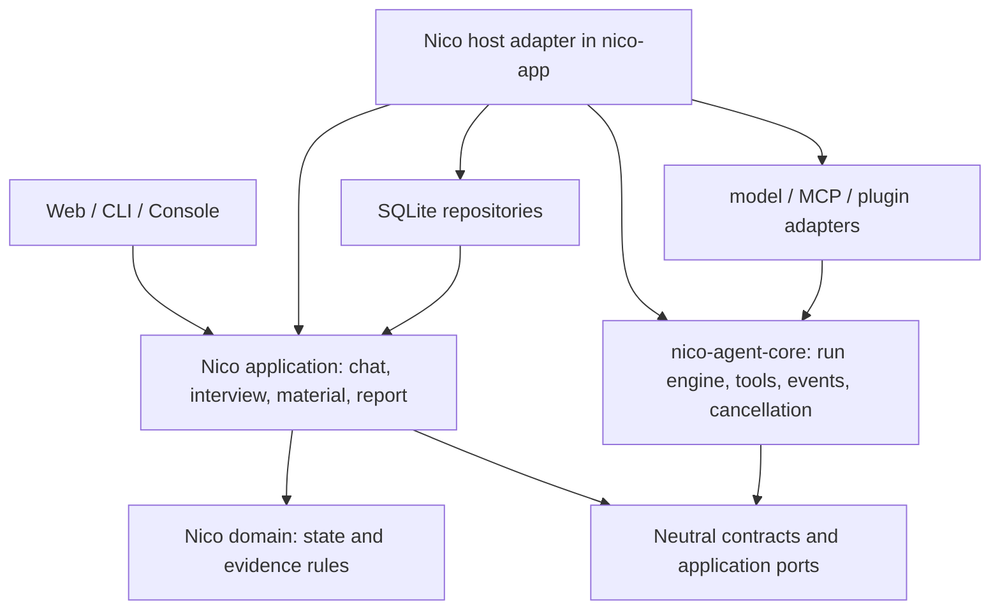

# Nico-agent 通用 Agent 底座重塑执行计划

> **给执行者：**按本文任务顺序逐项实施。每项先固定外部可见行为，再修改实现，并在本项验证通过后进入下一项。适用 `ub-mode` 的「First Make it Work → Then Make it Right → Follow Practice」和 `superpowers:executing-plans` 的逐项执行方式。本计划是实施依据，不代表其中任务已经完成。

**Goal：**将现有 Nico-agent 演进为可由面试、聊天及其他业务宿主复用的强健 Agent 运行时，同时保留现有求职产品的行为、数据和入口。

**Architecture：**保留现有单仓库与包依赖方向，以 `nico-agent-core` 作为通用执行引擎；`nico-application` / `nico-domain` 拥有求职业务决策；`nico-app` 负责装配与业务宿主接线；模型、工具、插件、存储和界面通过端口接入。按真实业务链路迁移，先建立可验证的运行契约，再迁移聊天和面试，最后扩充事件、插件及性能能力。

**Tech Stack：**Python 3.11+、asyncio、Protocol/TypedDict/dataclass、FastAPI、SQLite、httpx、unittest；使用仓库现有依赖和构建脚本。新增第三方运行依赖需要单独给出性能或能力证据。

**Spec：**本文件第 1—5 节为新的底座目标；现行产品语义以 `docs/项目定义.md`、`README.md` 为准。`EXECUTION_PLAN.md` 记录此前九包工程化计划和历史验收，执行时须核对其已经落地的条目，避免重复建设。新目标与旧计划方向不一致时，以本文件的「可复用底座」目标为后续架构依据，同时维持第 6 节兼容约束。

**基线：**2026-11-03 只读审视时，仓库位于 `main`，HEAD 为 `88c451b`，`git status --short` 无未提交项；此信息仅用于定位审视版本，实施前必须重新检查工作区。本文未改动产品代码，也未运行产品测试。

**审视范围：**已扫描包目录、测试与构建脚本，并阅读现行架构文档、Core、组合根、聊天/面试用例、提示与上下文、工具授权、模型传输、MCP、插件、渠道和对应参考项目的相关源码及提示调用链。这是针对重塑目标的架构审视，未逐行审计前端资源和所有测试实现，也未连接真实模型；这些验证由 T00 和后续任务承担。

## 0. 如何使用这份计划

1. 执行者每次开始一个任务，先重新阅读 `AGENTS.md`、本计划对应任务、涉及源码及三个参考项目的相关实现。本文中的路径和现状是基线证据，不代替实施时重新核对。
2. 按任务编号执行。任务内出现「条件任务」时，仅在列出的触发证据成立后启动；不能为了凑齐模块清单而实施。
3. 每项任务以行为测试或等价可观测结果开头。先确认测试因预期的缺口失败，再做最小实现。无法写诚实的自动化测试时，记录可复现的人工验证和原因。
4. 每项任务都要检查 `git diff --check`、变更文件范围及相关现有测试。包边界有变更时运行 `python scripts/check_dependency_graph.py --require-all`。每个阶段结束运行跨包回归；发布相关变更再执行 wheel 构建和隔离安装验证。
5. 实施记录必须写明：任务编号、做法及原因、实际验证命令与结果、未验证风险、回退办法。不得把模型质量、性能收益或跨进程语义写成已验证，除非有当轮证据。
6. 当前 `AGENTS.md` 规定在 `main` 开发、通过验证后默认提交，未经明确授权不 push。执行阶段遵守这一规则；本文的产出本身不授权发布或推送。

## 1. 产品目标与底座目标

### 1.1 用户要得到的能力

Nico-agent 目前的聊天、材料处理、模拟面试和报告闭环继续可用。面试业务应当像一个宿主：提供岗位目标、授权材料、题目状态、反馈规则和结果提交；通用运行时提供模型调用、工具执行、流式事件、预算、取消、错误、插件和可观测性。以后接入另一个业务宿主时，原则上只新增其上下文、工具政策和结果处理，不改通用模型循环。

「强底座」通过以下可检查事实定义：

| 编号 | 可检查目标 | 证据形式 |
|---|---|---|
| G1 | 通用运行包不导入求职业务、SQLite、Web/CLI 或具体模型协议 | 依赖图检查、源码导入检查、独立安装测试 |
| G2 | 同一运行契约同时服务聊天和面试，另有一个无求职依赖的示例宿主可调用 | 宿主契约测试和独立 smoke test |
| G3 | 模型看到的工具声明与执行时解析的工具来自同一不可变快照；授权撤销或会话版本变化不能让旧运行越权 | 并发/撤销/版本竞态测试 |
| G4 | 每次引擎尝试有明确的开始、流事件、工具事件和终态；业务提交结束后 Web 才发最终成功。取消、失败和成功不会给订阅方相互矛盾的终态 | 事件顺序、面试重试与业务校验异常测试 |
| G5 | 不同会话可并发；同会话旧版本结果不会覆盖新状态；进程内取消可生效，跨进程行为有明确边界 | 存储原子提交和并发测试 |
| G6 | 模型、插件、MCP 的失败不会泄露上游密钥或原始私有材料；不确定副作用不会因自动重试而重复执行 | 端到端错误/安全测试 |
| G7 | 与基线相比，关键本地开销有重复可测的数据；优化必须报告改善或回归，不把模型网络延迟算作本地引擎收益 | 固定数据与环境的 benchmark 报告 |

### 1.2 边界与术语

| 术语 | 唯一含义与所有者 |
|---|---|
| Agent engine / 底座 | 与求职无关的单轮及多轮模型—工具执行、取消、预算、事件和能力快照；归 `nico-agent-core`。 |
| Host / 业务宿主 | 决定本轮目标、事实来源、可用工具、提示词、输出校验及提交方式；Nico 的聊天与面试分别是宿主流程。 |
| Run / 运行 | 一个会话版本的业务处理；可能因面试输出校验而包含至多一次重试。每次调用通用引擎称为一个 execution attempt（引擎尝试）。 |
| Session / 会话 | 业务持久状态及历史；由 application/domain/storage 决定合法转移与提交。 |
| Tool capability snapshot / 工具能力快照 | 本轮模型声明、工具名称、参数模式、执行器和只读/并发属性的一致视图；运行开始后不可变。 |
| Event / 运行事件 | 描述运行过程或终态的数据；事件观察者不得改变授权与业务提交。工具调用前置决定走显式政策接口。 |
| Message bus / 渠道消息总线 | 跨入站渠道与业务处理的队列/路由机制；与运行事件分发是两件事。 |
| Plugin / 插件 | 被显式装载的可信扩展，实现约定的能力及生命周期；同步插件超时不意味着线程停止。 |

### 1.3 本阶段不作的承诺

本计划不把 Agent 底座等同于多 Agent 编排、自动联网搜索、任意代码执行或公网生产部署。语音、远端 MCP/OAuth、第二外部渠道、跨进程取消、非可信插件隔离和自动记忆写入按第 11 节的触发条件处理。仓库可以为这些能力保留清晰接口，但不能预先交付未经验证的实现。

## 2. 当前源码地图与业务调用链

### 2.1 真实包边界

根 `pyproject.toml` 声明九个发行包；`scripts/check_dependency_graph.py` 校验包声明、源码导入和禁用依赖。`nico-contracts`、`nico-domain` 位于底层；`nico-agent-core` 目前只依赖 contracts；`nico-application` 持有业务用例与端口；`nico-adapters`、`nico-storage` 实现外部能力；`nico-web`、`nico-cli` 为入口；`nico-app` 是组合根并保留 `career_agent.*` 兼容导入。

```text
nico-web / nico-cli ──> nico-application ──> nico-domain, nico-contracts
                                 ▲
                                 │ 应用端口由具体实现提供
nico-adapters ──> nico-agent-core ──> nico-contracts
nico-storage  ──> nico-application
            nico-app：选择模型与账户库、组装上述对象、管理服务生命周期
```

### 2.2 主要流程、位置和依赖

| 流程 | 入口到提交的实际位置 | 底座与业务边界 |
|---|---|---|
| 材料输入 | `nico_web/material_routes.py` → `nico_adapters/extract.py` 提取 → `nico_application/use_cases.py:MaterialUseCases` 校验 → `nico_storage/store/materials.py` 保存。 | 文件格式解析是适配器；材料与经历确认是求职业务，不应进入 engine。 |
| 聊天 | `nico_web/chat_routes.py` 或 `nico_cli/cli.py` → `ChatUseCases` 认领消息 → `nico_app/runtime.py:AgentRuntime.run` 组装上下文/工具 → `nico_agent_core/core.py:AgentCore.run` 调模型/工具 → `commit_chat_result` 和 Store 提交。 | 聊天提示、固定备注、记忆授权属于宿主；模型—工具执行、预算和运行事件属于底座。 |
| 模拟面试 | `nico_web/interview_routes.py` 或 CLI → `InterviewUseCases` 认领题目/回答 → 同一 AgentRuntime/Core → `commit_interview_result` 校验 JSON、证据与题数阶段 → `nico_storage/store/interviews.py` / `runs.py` 提交。 | 面试状态机、证据和反馈规则归业务；底座只返回中性的模型结果。 |
| 报告/复练 | `InterviewUseCases` 与 `nico_storage/store/interviews.py` 读取已提交反馈，`nico_application/session_use_cases.py` 支持详情与导出，Web/CLI 展示。 | 报告不是引擎输出格式；引擎不应理解题号、评分、复练。 |
| 提示与材料上下文 | `nico_application/context.py` 从 `resources/prompts/{chat,interview,interview_retry}.md` 取提示、计算版本并组装授权材料/历史；`AgentRuntime` 调用。 | 提示文本是业务政策；底座可复用预算与消息约束，但不注入求职提示。 |
| 模型 | `nico_adapters/models/provider.py` 选择 demo/OpenAI Chat/Anthropic；`transport.py` 处理 HTTP、SSE、错误及有限重试；Core 通过 `ModelPort` 调用。 | 协议差异保留在适配器；运行时需要稳定的完整/流式能力契约。 |
| 外部工具 | `nico_application/tooling.py` 形成授权快照；`nico_app/runtime.py` 发现、参数校验和执行；`nico_adapters/mcp.py`、`plugins.py` 连接外部实现；`nico_application/tools.py` 处理内置工具。 | 用户授权与资源范围属业务；名称/模式验证、执行顺序、事件与结果归通用执行边界。 |
| 渠道 | `nico_application/channels.py:ChannelRouter` 使用 `nico_storage/store/channels.py` 的绑定/入站认领/投递账本，`nico_adapters/console.py` 为现有渠道。 | 目前只有 Console；账本可重启恢复，但不存在需要跨多渠道调度的消息总线。 |

### 2.3 已存在的底座能力

- `AgentCore` 已有最多 4 轮模型请求、8 个工具调用、120 秒时限、模型输入/输出限制、用量累计、只读工具批次并行、取消/版本检查和部分流事件。
- `ToolCatalogSnapshot` 已把工具声明与外部执行器冻结在本轮；`ToolGrantUseCases` 将只读授权与会话运行状态关联。已有竞态测试，迁移时应保留其语义。
- `LocalPlugins` 有 load、prepare、activate、retire、close；MCP 支持本地 stdio、发现与调用。二者目前仍按可信本地扩展管理。
- SQLite 有会话版本提交、运行事件、账户隔离、迁移、备份恢复及渠道幂等账本。`career_agent.*` 是兼容路径，不能因重塑直接删除。
- `benchmarks/run_baseline.py` 与 `benchmarks/results/stage8-baseline.json` 为已有单机基线；它们没有证明真实模型服务延迟、跨进程安全或面试质量。

## 3. 参考项目的源码依据与取舍

三个路径在本次审视中均可访问。表中「实际做法」只描述已查看的源码；「Nico 决定」是本计划的设计建议。参考代码及提示词不得整段复制。

| 参考 | 已读源码与实际做法 | Nico 决定 |
|---|---|---|
| Pi | `E:/Agent/Pi-agent/pi/packages/agent/src/agent-loop.ts` 用通用消息、工具、事件和取消驱动循环；`packages/coding-agent/src/core/agent-session-runtime.ts` 管会话宿主；`system-prompt.ts` 从选中工具与上下文组装提示，`extensions/loader.ts` 在扩展装载期登记工具/处理器。 | **采用**引擎与宿主分层、统一工具声明/执行路径及可观察事件；**调整后采用**提示资源组装，只保留 Nico 确实需要的区段；**不采用**编码 Agent 的文件工具、TUI 与完整扩展表面。 |
| nanobot | `E:/nanobot/nanobot/agent/runner.py:AgentRunner` 声明不承载产品层关注点，`agent/loop.py` 协调轮次与渠道；`agent/tools/registry.py` 登记和准备工具；`bus/queue.py` 用入站/出站 asyncio 队列隔离渠道；`agent/context.py` 在构造提示时调用 `templates/agent/tool_contract.md`。 | **采用**Runner/宿主分界和工具契约；**调整后采用**渠道 bus 的设计条件；**不直接采用**无界队列、子 Agent、命令和定时任务全量能力。 |
| Akashic-agent | `E:/Akashic-agent/akashic-agent/bootstrap/tools.py` 装配 CoreRuntime、MessageBus、EventBus、工具和插件；`agent/looping/session_lane.py` 使同一 session 串行；`bus/event_bus.py` 区分观察与干预；`agent/tool_hooks/executor.py` 在真实工具调用前决定参数或拒绝；`agent/context.py` 调用 `prompts/agent.py` 的提示块。 | **采用**显式组合根、会话隔离、调用前确定最终授权与参数；**调整后采用**观察事件分发；**不采用**主动任务、人格记忆和完整 hook 平台，直到 Nico 有可证明需求。 |

这些项目的代码规模与用途不同。对 Nico 的验收应看复用、正确性和可测性能，不看包或模块数量是否接近参考项目。

## 4. 问题清单：证据、影响、风险与优先级

| 优先级 | 源码证据 | 影响与实施判断 |
|---|---|---|
| P0 | `nico_app/runtime.py:AgentRuntime.run` 同时处理业务上下文、工具发现、通用运行、面试重试、结果提交和运行记录；Core 只能拿已经拼好的多项回调执行。 | 通用底座能力分散在业务组合层，第三宿主难以直接复用完整运行契约。先建立中性契约与行为护栏，再逐段迁移；不能一次性重写。 |
| P0 | `nico_agent_core/core.py` 的 `_ACTIVE_RUNS` 是模块级字典，`track_session_run` / `cancel_session_runs` 是类方法；`AgentRunRequest.messages` 在循环中被原地追加。 | 两个引擎实例难以保证运行登记和输入对象隔离。当前单进程 Nico 会话 ID 设计降低了冲突概率；作为通用底座仍需按实例隔离并验证。 |
| P1 | `nico_agent_core/ports.py:ModelPort` 仅声明 `complete`，Core 通过 `getattr(model, 'stream')` 动态探测流式能力；`nico_contracts/messages.py` 的字段大多可选。 | 协议实际能力与类型契约不一致，非法消息可进入深层循环。先在适配器边界解析/验证并给流式能力明确定义，避免全仓同时改消息表示。 |
| P1 | `nico_application/tooling.py` 保存快照；`nico_app/runtime.py` 持有外部工具解析/执行/参数校验；`nico_application/tools.py` 持有内置执行。 | 模型声明与执行路径已努力保持一致，但通用工具执行仍分散。抽取中性工具执行机制，保留应用授权和资源规则。 |
| P1 | `nico_contracts/events.py` 只有 `text_delta` / `tool_start` 等轻量事件；Web SSE 在 `nico_web/workflow_support.py` 为每次请求创建自己的队列，Store 另存最终 run 摘要。 | 多消费者、事件顺序与背压没有统一边界。先定义运行事件契约，再实现有界分发；SSE 继续使用现有外部格式。此处是运行事件分发，不等于渠道消息总线。 |
| P1 | `nico_adapters/plugins.py` 的同步调用在 `asyncio.to_thread` 中执行，超时仅停止等待；`retire()` 关闭新调用入口。 | 扩展生命周期已存在，但不能承诺超时线程被取消。先记录、隔离和在途快照语义；不在无可信隔离需求时引入进程沙箱。 |
| P2，待测 | `nico_adapters/models/transport.py` 的 `post_json` / `post_sse` 各创建一个 `httpx.AsyncClient`。 | 可能损失 keep-alive，也可能被远端模型延迟淹没。先用固定端点测连接复用收益和资源关闭，再决定是否改变客户端生命周期。 |
| P2，条件 | 当前渠道只有 Console，`ChannelRouter` 与 SQLite 账本已提供绑定、入站幂等及投递重试。 | 仅凭一个渠道尚不能证明需要渠道 MessageBus；出现第二异步渠道或独立后台消费者时，再以明确队列容量、确认和崩溃语义引入。 |

以上 P0/P1 是架构与可维护性判断，不代表当前产品已发生对应故障。模型质量、真实延迟、跨进程取消和不可信插件风险仍须分别验证。

## 5. 方案比较与选定路线

| 方案 | 做法 | 收益与代价 |
|---|---|---|
| A. 全量重写成通用平台 | 新建完整 runtime、bus、插件框架，再把面试迁入。 | 可重新设计全部接口，但兼容 API、数据库、测试和面试事实边界的风险最高；调试周期长。 |
| B. 保持现状仅补功能 | 持续在 `nico_app/runtime.py` 添加各业务需要的分支。 | 短期最少改动；长期通用能力继续依赖求职业务对象，难以达到「换宿主仍能工作」的目标。 |
| **C. 引擎优先的纵向切片** | 先把运行/工具/事件契约固定在底座，给旧入口桥接；依次迁移聊天和面试；每一步保留外部行为并验证。 | 能每项独立验收，保留现有数据与用户路径。需要短期兼容桥和严格的删除时机。**本计划采用 C。** |

选择 C 不意味着只能做局部修改。用户已授权未来必要的全局架构与代码调整；执行仍须以每一步可验证、可回退为条件。九包结构暂作工作区基线。只有职责边界或发布成本的真实证据要求时，才新增、合并或删除发行包。

## 6. 全局兼容约束与审查重点

### 6.1 不可静默改变的行为

- HTTP 路由、请求/响应字段、状态码、稳定错误码与 SSE 对外事件格式；CLI 命令与退出码；`python -m career_agent` 和既有 `career_agent.*` 导入。
- `DATA_DIR`、单用户与账户业务库路径、`auth.sqlite3`、现有 SQLite schema、迁移与备份恢复语义。重塑若不需要 schema 改动，就不要迁库。
- 用户回答先落库、面试阶段合法性、回答原文证据验证、报告只使用已提交结果、聊天与面试会话隔离、长期记忆必须确认。
- 会话版本防迟到提交，同一会话版本最多一个模型运行；外部工具只读授权、调用前再次检查、工具结果不作为指令。
- 现有预算默认值与错误码：4 轮、8 次工具、120 秒、64,000 字符模型输入、12,000 字符输出、累计 token 阈值 16,000（仅在端点提供用量时可据此执行）。

### 6.2 五类重点失败输入

| 场景 | 用户可见的期望行为 | 归属任务 |
|---|---|---|
| 模型返回截断的工具调用参数或不正常结束原因 | 不执行工具；本轮返回稳定错误，已保存用户输入可重试 | T03、T04 |
| 工具授权修改与模型请求并发，或会话版本被新输入替换 | 运行期间的授权修改被拒绝；旧运行不能使用新授权或写入迟到结果 | T04、T06、T07 |
| 流订阅者变慢或断开 | 队列内存有界；仍连接的订阅者能收到终态，断开的订阅者被清理；取消/断开策略明确 | T05 |
| 插件在运行中 retire、超时或抛错 | 已开始调用与尚未开始调用有明确差异；后者不能越过 retire 执行，错误或线程状态如实报告 | T09 |
| 运行在模型调用后、业务提交前崩溃 | 用户输入与会话状态仍可被恢复/判断；不自动重复执行不确定副作用 | T06、T07、T12 |

### 6.3 每任务通用开发循环

每项代码任务都执行以下步骤，任务中再列出特有断言与命令：

- [ ] 查 `AGENTS.md`、工作区已有改动和本项涉及文件；记录前置测试与真实结果。
- [ ] 写一个调用公开路径的失败行为测试；确认失败原因与任务目标一致。
- [ ] 实现最小改动，保持现有风格与包依赖方向；删除只因本次改动产生的孤立代码。
- [ ] 运行定向测试、`python scripts/check_dependency_graph.py --require-all`（跨包时）、`git diff --check`，并查看 `git diff --stat` 与完整 diff。
- [ ] 若测试失败，定位根因，修复后只重跑受影响范围；关键门禁未过时停止该任务，不继续堆新改动。
- [ ] 记录变更日志、风险与回退；验证通过后按仓库 Git 规则只提交本项文件。

### 6.4 代码与接口规范

- 优先把外部字典、JSON、HTTP 响应和插件声明在进入底座时解析为有约束的形状；内部不靠散落的 `get()`、`getattr()` 和重复校验猜测数据。类型检查不能用无理由的 `Any`、强制转型或忽略注释绕过。
- 领域规则尽可能是纯函数；业务状态更改只能由有版本前提的用例和事务提交。一次决策只保留一个权威实现，迁移期兼容代码只做转发。
- 每个异步资源明确拥有者和关闭点。共享可变状态必须有单一写入边界或不可变快照；不同运行不共享可被修改的消息列表、工具目录和事件队列。
- 错误在入口或适配器边界分类，向外只暴露稳定错误码与必要说明。日志和运行事件不含 API Key、用户原文材料、插件原始参数或上游响应正文。
- 对不确定副作用的模型/工具调用不做透明自动重试。可安全重试的只读发现与明确失败的 429/503 请求维持现有有限策略，变更前先写对应行为测试。
- 用公开入口验证功能：Core 用独立宿主调用，应用用例通过其端口调用，Web/CLI 通过实际请求和命令调用。测试应在错误实现下失败，不能只复刻内部方法或断言 mock 被调用。
- 仅对本次触及的复杂函数和重复片段做整理；`crapper`、`dryer`、`mutator` 若可用，结合测试结果定位改动风险，不能把工具分数当作替代业务验收的目标。

## 7. 目标结构、运行接口与数据所有权

### 7.1 目标依赖图



`nico-app` 可以同时依赖各包以完成装配；`nico-agent-core` 必须保持不导入 application/domain/storage/adapters/web/cli。业务宿主通过稳定运行接口传入消息、工具快照、预算、当前性判断和事件接收器；核心返回中性结果。业务提交由 application + storage 完成。

### 7.2 拟固定的最小公共契约

以下名字是实施目标，第一项任务可在测试与现有兼容面证据下小幅调整；调整要在本计划记录一次，后续任务统一使用。新增类型以 `nico_agent_core` 内部 dataclass/Protocol 起步，必要的跨包纯数据形状放 `nico_contracts`，不新建发行包。

| 契约 | 字段或方法 | 所有者与规则 |
|---|---|---|
| `RunKey` | `namespace: str`、`session_id: str`、`version: int`、`attempt: int = 0` | 宿主给定；每次引擎重试使 attempt 递增，进程内运行登记按完整 key 隔离。Nico 的 namespace 至少区分 chat/interview，不能由全局模块变量推断。 |
| `RunPolicy` | `max_turns=4`、`max_tool_calls=8`、`timeout_seconds=120`、`max_input_chars=64000`、`max_output_chars=12000`、`max_reported_tokens=16000` | 在运行创建时冻结；默认值与现行行为一致。差异必须由宿主显式传入并有用例证据。 |
| `PreparedRun` | `key`、`model`、不可变初始 `messages`、`ToolSnapshot`、`policy`、`is_current`、`on_event` | 底座输入。模型/工具/事件端口清晰类型化；引擎在内部复制消息，绝不原地改宿主传入集合。 |
| `RunOutcome` | `content`、`trace` | 仅在该次引擎尝试成功时返回；中断、取消和失败继续通过明确异常传播。引擎不解析面试 JSON，不调用 SQLite，不决定报告内容。 |
| `ToolSnapshot` | 本轮 `definitions`、按工具名查找执行器和属性、`execute(name, parsed_args)` | 一次构造，同一对象控制模型声明与执行。用户授权及资源范围在构造前由宿主确定，并在实际调用前按会话版本复核。 |
| `ModelPort` / `StreamingModelPort` | `complete(messages, tools)`；流式端口另提供 `stream(messages, tools, on_delta)` | 协议适配器明确声明能力；禁止 Core 通过任意 `getattr` 猜测。非流式模型仍可产生一次完整文本事件。 |
| `RunEvent` | `run_key`、单调 `sequence`、`type`、安全的元数据；每次引擎尝试终态恰好一种 | 底座内事件可新增字段；Web 对外 SSE 经宿主映射保持现有格式，`done` 只能在业务校验及提交之后发送。事件正文禁止携带密钥、工具参数及原始材料。 |

接口的引入顺序是：先中性数据形状和兼容桥，再把运行、工具与事件的通用实现收进 Core；旧 API 在迁移期转发。`nico_application` 的工具授权、面试规则和上下文提示仍属于求职宿主。通用能力只有在两个独立宿主使用时才值得扩大公开 API。

### 7.3 一次业务运行的时序与失败归属

```text
宿主：在事务中认领会话版本，并先保存用户输入
  → 宿主：准备提示、事实来源、工具授权与本轮能力快照
  → 引擎尝试 0：模型/工具循环，发执行过程事件，返回中性 RunOutcome
  → 宿主：按聊天/面试规则校验结果；面试可在既有安全条件下发起尝试 1
  → 宿主：以原会话版本作条件提交业务结果
  → 宿主：提交成功后向 Web 发送 done；失败/中断发对应 error/状态
  → 最终记录：每次引擎尝试有自己的安全事件，业务运行记录与会话版本关联
```

引擎「完成」只表示模型/工具执行结束；面试 JSON 校验、回答证据、版本提交都可能随后拒绝结果。引擎事件必须按 `attempt` 区分，Web 的成功终态必须等业务提交。若模型调用后进程退出，已落库的用户输入继续存在，不能因为看见一次执行完成事件就假定报告已写入。工具执行前由宿主给出的 `is_current` 检查版本；最后提交仍由 Store 的版本条件保护。面试重试沿用同一次业务运行的总预算和已授权能力快照，不扩张工具权限。

### 7.4 目录调整原则

| 现有位置 | 计划归属 | 条件 |
|---|---|---|
| `nico_agent_core/core.py` | 保留执行循环；确有复杂度时在同包内拆 `run.py`、`tools.py`、`events.py`、`cancellation.py`。 | 先看单项修改是否令文件职责混杂；不为目录对称而拆。 |
| `nico_application/tooling.py` | 保留授权用例；通用工具快照/参数准备可在兼容桥下迁入 Core。 | 迁移后 application 不应反向依赖 Core；公共纯形状放 contracts。 |
| `nico_app/runtime.py` | 逐步收敛为 Nico 宿主适配与编排：选上下文、授权、业务重试、结果提交。 | 通用模型循环、工具调用顺序、事件派发不再重复实现。 |
| `nico_application/context.py` 与 prompts | 保留面试/聊天提示和事实来源；提取纯预算算法需有第二宿主复用证据。 | 不把求职提示复制到 Core。 |
| `nico_adapters/models/*`、`mcp.py`、`plugins.py` | 保留协议和可信扩展实现；按核心契约适配。 | 无实测收益时不换 HTTP/插件技术栈。 |
| `nico_storage/*`、`nico_web/*`、`nico_cli/*` | 保留存储和界面职责。 | 仅因新增底座接口而做必要映射；不趁机重排 UI 或迁库。 |

## 8. 分阶段任务清单

### 阶段 A：冻结基线与接口（先做）

#### T00. 建立可重放的现状验收记录

**文件：**只读检查现有 `tests/`、`packages/*/tests/`、`.github/workflows/tests.yml`、`benchmarks/run_baseline.py`；必要时只新增 `tests/test_runtime_compatibility.py` 中缺失的用户行为断言。**依赖：**无。

- [x] 重查 HEAD、分支、已有改动，写下与本任务无关文件；不能覆盖它们。
- [x] 固定 Web 聊天一次工具调用、面试首题—回答—报告、CLI 恢复、SSE、取消/版本竞态、插件和 MCP 错误的现有测试入口。仅在确有缺口时补一个外部行为测试。
- [x] 运行当前定向测试、依赖图检查及完整回归各一次，记录失败、跳过和环境条件；旧文档中的 214 项通过是历史信息。
- [x] 记录当前本地 benchmark 的机器、数据集、运行次数和指标口径；真实模型延迟另列为待测，不伪造基线。

**验收：**得到任务执行前的命令、结果和兼容矩阵；任何已有失败都在变更前注明，不把它归因于重塑。

#### T01. 固定运行契约与边界检查

**文件：**`packages/nico-agent-core/src/nico_agent_core/` 内新增中性类型文件，更新 `ports.py`、`__init__.py`；需要跨包传递的数据形状放 `nico-contracts`；测试 `packages/nico-agent-core/tests/test_core.py`；必要时改 `scripts/check_dependency_graph.py`。**依赖：**T00。

- [ ] 先写测试：两个不同 namespace 的同名 session/version 可同时运行；同一版本的 attempt 0/1 各有独立运行标识；相同 run 输入的消息在执行后保持原值；非法初始消息在引擎入口得到稳定错误且不调用模型；自定义 token 阈值与默认 16,000 阈值均按传入政策生效。
- [ ] 引入第 7.2 节的 `RunKey`、`RunPolicy`、`PreparedRun`、`RunOutcome` 最小形式，默认预算保持现值；保留旧 `AgentRunRequest` 转发路径供当前宿主使用。
- [ ] 在依赖图检查中确认 Core 不导入求职包；对 `RunPolicy` 的非法值只在外部构造边界验证一次。
- [ ] 运行 Core 测试与依赖图检查，审查公开导出是否有一次性、无使用者的类型。

**验收：**中性接口可由假模型和假工具独立使用；Nico 业务包不成为 Core 的依赖，原入口行为通过。

### 阶段 B：把执行能力集中到引擎

#### T02. 运行登记、取消与版本当前性

**文件：**`nico_agent_core/core.py`，必要时同包 `cancellation.py`；`nico_app/runtime.py` 仅调整桥接；测试 `packages/nico-agent-core/tests/test_core.py`、`tests/test_core.py`。**依赖：**T01。

- [ ] 先写测试：两个 Engine 实例的相同 RunKey 不互相取消；取消旧版本不取消新版本；跨线程调用取消只作用于所属事件循环；运行结束后登记释放。
- [ ] 将模块级 `_ACTIVE_RUNS` 迁为引擎实例持有的登记表，并用明确的 `RunKey` 索引；组合根为同一宿主复用同一个 Engine 实例。兼容的按 session ID 取消入口查找该实例内匹配的 key。
- [ ] 保留 `AgentRuntime.cancel_session_runs` 的可见行为，通过实例或兼容代理调用；不得留下同时维护两份运行表的过渡状态。
- [ ] 验证聊天补充消息、面试更正/暂停、删除会话时旧运行结果仍不能提交。

**验收：**隔离/取消测试通过，运行登记可清空；单进程语义明确。跨进程取消仍是条件任务。

#### T03. 模型完整/流式协议与响应解析

**文件：**`nico_agent_core/ports.py`、`core.py`、`nico_adapters/models/provider.py`、协议适配器及相关测试。**依赖：**T01。

- [ ] 先写测试：仅支持 complete 的模型仍能运行；支持 stream 的模型按顺序发增量；截断的工具调用绝不执行；无效结束原因返回现有稳定错误。
- [ ] 用显式 `StreamingModelPort` 或能力声明替换 Core 的动态 `getattr(stream)` 探测；在适配器入口将厂商响应转换成中性结果，禁止厂商字段进入 Core。
- [ ] 只在外部数据入口解析工具调用 ID、名称、参数结构；内部执行使用已经验证的结构，不在每层反复猜字典形状。
- [ ] 保持当前 OpenAI Chat、Anthropic 和 demo 的差异与 SSE 对外格式；按协议适配器分别做定向测试。

**验收：**完整/流式契约由类型和测试表达，工具调用截断不执行，原三类模型路径维持既有外部行为。

#### T04. 工具能力快照与统一执行入口

**文件：**`nico_application/tooling.py`、`nico_app/runtime.py`、`nico_agent_core` 同包工具模块、`nico_adapters/mcp.py`、`plugins.py` 的最小适配；测试 `packages/nico-application/tests/test_tooling.py`、`packages/nico-agent-core/tests/test_core.py`、`tests/test_tool_grant_race.py`、`tests/test_extensions.py`。**依赖：**T01、T03。

- [ ] 先写测试：模型声明的每个工具名可在同一快照解析；未声明工具不能执行；参数 schema 错误不触发实现；只读调用可并发而非只读调用保持顺序；MCP/插件工具同名冲突被拒绝。
- [ ] 将中性的名称解析、参数准备/校验、执行顺序和工具结果归一集中到 Core；`ToolGrantUseCases` 继续决定用户授权，宿主负责资源/会话范围。
- [ ] 快照由本轮工具清单、已授权名称及执行器构造一次；运行开始后不能由插件热变更或另一请求修改；旧公开导入先转发以保持兼容。
- [ ] 在最终参数确定、授权和当前版本核对之后才调用真实工具；不确定副作用不自动重试。

**验收：**提示/模型工具声明和执行映射来自同一快照；未授权、写工具、无效参数均不会进入适配器；原竞态测试通过。

#### T05. 运行事件契约与有界观察分发

**文件：**`nico_contracts/events.py`、Core 同包事件模块、`nico_web/workflow_support.py`、`nico_storage/store/runs.py` 的必要映射；测试 Core、Web SSE 与运行事件存储。**依赖：**T02、T03、T04。

- [ ] 先写测试：每次引擎尝试的 sequence 单调，成功/失败/取消恰好一种引擎终态；面试输出校验失败时 Web 不发送 `done`；订阅者异常不改变工具授权；慢订阅者时内存有上限且连接仍在时最终终态不丢失。
- [ ] 定义观察型运行事件分发接口；订阅者只读。工具前置拒绝、参数修改和资源授权通过显式调用链完成，不能藏进事件处理器。
- [ ] 对文本增量采用有界队列或合并策略，并明确慢消费者与取消时如何关闭；Web 映射继续发既有 `started`、`text_delta`、`tool_start`、`done`、`error`。
- [ ] 运行日志只保存安全摘要，复用现有 `run_event` 语义；不持久化工具原始参数、密钥或材料正文。

**验收：**至少 Web SSE 与运行观测两个独立消费者能使用同一事件源；事件顺序、终态和背压有测试；外部 SSE 兼容。

### 阶段 C：让聊天和面试成为清晰宿主

#### T06. 聊天宿主接入新引擎

**文件：**`nico_app/runtime.py`、`nico_application/use_cases.py`、`nico_application/context.py` 的必要桥接，Web/CLI 不改公开路径；测试聊天单元、API、CLI。**依赖：**T02—T05。

- [ ] 先写行为测试：已确认经历与明确授权材料可读取；未授权材料不能读；新用户消息使旧回复失效；失败后 `/retry` 复用原用户消息；工具事件对 Web 可见。
- [ ] 聊天宿主准备提示、最近消息、固定备注和授权资源，生成 `PreparedRun`；调用引擎取得 `RunOutcome`；用现有 Store 版本提交结果。
- [ ] 把只用于聊天的结果处理留在 application/host；从 `nico_app/runtime.py` 删除因此不再需要的通用工具循环/事件分支。
- [ ] 对 Web JSON、Web SSE、CLI 各走一次现有端到端测试。

**验收：**聊天通过新契约运行，用户可见行为与 T00 基线一致；Core 源码无聊天专用字段。

#### T07. 面试宿主接入新引擎

**文件：**`nico_app/runtime.py`、`nico_application/interview_use_cases.py`、`nico_application/context.py`、`nico_domain/interview.py` 的必要调整；测试面试 API/CLI/领域规则。**依赖：**T06。

- [ ] 先写行为测试：首题、普通回答、最后一题、跳题、暂停/恢复、回答更正、证据原文错误、报告与复练均保持既有结果。
- [ ] 面试宿主准备岗位目标、本场授权材料、面试进度和提示词版本；调用同一引擎；业务层解析、校验并提交 JSON 结果。
- [ ] 只在面试输出校验失败且没有不确定副作用时执行现有单次重试；重试使用 attempt 1、同一授权快照和业务运行剩余时限，失败的用户回答保留供恢复。
- [ ] 去掉 Core 中任何题号、feedback、evidence 或报告概念；检查旧 `AgentRuntime` 的直调兼容路径是否仍被测试/公开入口使用，有使用者则提供明确转发。

**验收：**面试全链路使用同一通用引擎，报告仅由已提交业务结果产生，聊天数据不进入面试上下文。

#### T08. 用第三种宿主证明可复用

**文件：**优先在 `packages/nico-agent-core/tests/` 创建独立示例/契约测试；如确有真实使用者，再添加 `examples/` 下小型宿主；不新增产品页面。**依赖：**T06、T07。

- [ ] 实现一个无 `nico_application`、`nico_domain`、`nico_storage` 导入的最小宿主：自有提示、假模型、一个只读工具和结果处理。
- [ ] 测试完整循环、流事件、取消、预算、工具快照、插件可选接入；用包独立安装环境运行该示例。
- [ ] 查找运行底座是否仍要求 `kind == 'chat'/'interview'`、Store 字段或固定全局对象；发现即回到所属任务修正。

**验收：**第三宿主不修改 Core 即可运行；证明的是接口可复用，不声称其业务已可投入使用。

### 阶段 D：扩展、渠道与性能

#### T09. 插件生命周期和在途运行一致性

**文件：**`nico_adapters/plugins.py`、`nico_adapters/registry.py`、组合根关闭流程；测试插件与工具竞态。**依赖：**T04、T05。

- [ ] 先写测试：插件加载失败不留下半注册工具；已开始的工具调用在 retire 后按现有超时/完成语义结束；尚未开始的调用在 retire 后被拒绝；新运行看不到已 retire 插件；close 释放可关闭资源。
- [ ] 明确 load→prepare→activate→retire→close 的状态和错误；运行快照保持模型声明稳定，但 retire 可以使待执行调用得到明确的 `plugin_retired` 结果。关闭时先停止新调用，再按已定义的等待/拒绝策略处理在途调用。
- [ ] 同步插件超时仍报告 `may_still_be_running`；出现非可信插件来源时另做进程隔离方案，不把线程超时包装为强取消。

**验收：**生命周期竞态可重现并通过；插件失败不破坏核心运行或污染下一轮工具目录。

#### T10. 模型传输与运行开销实测

**文件：**`benchmarks/` 固定数据及报告；只有证实收益后才修改 `nico_adapters/models/transport.py` / provider 生命周期。**依赖：**T03、T08。

- [ ] 分别记录本地上下文构建、快照构建、工具调度、SQLite 提交、HTTP 建连、模型端到端耗时；固定机器、数据、并发数、端点与采样次数。
- [ ] 对比现状每请求 `httpx.AsyncClient` 与可复用客户端的连接数、延迟和关闭行为。网络模型不可用时仅报告本地/假服务指标。
- [ ] 若决定复用，客户端由组合根拥有并在服务关闭时 close；测试不同模型配置、认证头与账户运行不会串用敏感状态。
- [ ] 记录 p50/p95、样本数、错误数和资源占用；若局部优化令正确性或稳定性回退，撤回该优化。

**验收：**性能结论可复现且有改善或明确的「暂无收益」结论；不凭主观感觉改变异步结构。

#### T11. 渠道 MessageBus（条件任务）

**触发条件：**确定第二个异步渠道或确有独立后台消费者，需要把入站、业务处理和出站投递解耦；同时已有队列积压/节流指标。**候选文件：**`nico_application/channels.py`、`nico_adapters` 渠道实现、`nico_storage/store/channels.py`，必要时在现有包内加 `channel_bus.py`。**依赖：**T05、T08。

- [ ] 先写契约测试：多渠道入站路由、同一消息 ID 的持久去重、队列有界积压、消费者取消、投递失败保留同一 delivery ID。
- [ ] 定义入站/出站消息和确认点；内存队列只负责调度，SQLite 账本继续拥有跨进程重启的事实。
- [ ] 给队列容量、拥塞时返回/等待策略和停机 drain 语义；不得把内存 bus 说成持久 exactly-once 投递。

**验收：**第二渠道/消费者确实受益，未改变现有 Console 与 SQLite 幂等契约。触发条件不成立时标记「未启动，原因有记录」。

### 阶段 E：发布与收口

#### T12. 兼容、构建、文档与发布门禁

**文件：**受影响包的 README/pyproject、根 `README.md`、`docs/项目定义.md`、`scripts/check_dependency_graph.py` 和 wheel 校验脚本的必要更新；保留 `EXECUTION_PLAN.md` 历史记录。**依赖：**T08—T10，T11 按条件。

- [ ] 再次检查所有公开 `career_agent.*` 导入、HTTP/CLI/SSE、账户隔离、数据库升级、备份恢复及现有案例；禁止静默换默认数据路径。
- [ ] 运行受影响包测试、跨包测试、依赖图、全部 wheel 构建和源码目录外的安装 smoke test；CI 在 Python 3.11 与 3.13 的结果须有记录。
- [ ] 将当前 CI 中遗漏的 Core、adapters、storage、CLI、Web 包级测试纳入 `.github/workflows/tests.yml`，确认安装顺序与本地构建一致。
- [ ] 对代码复杂度与重复做针对性检查；若 `crapper`、`dryer`、`mutator` 可用且能覆盖改动范围，记录其命令和结果。工具不可用时说明，不用臆造通过结果；优先保留有意义的行为测试。
- [ ] 更新架构图、包职责、插件与 bus 运行语义、第三宿主示例、性能基线和未完成条件任务。
- [ ] 对照第 1.1 节 G1—G7 填写验收矩阵。任一核心目标缺证据时写「未完成」及具体阻塞，不以测试数量替代结果。

**验收：**安装后的 wheel 与源码运行行为一致，已有数据可安全打开，产品业务完整，底座可被独立宿主调用且性能/可靠性结论有证据。

## 9. 每阶段验证命令与通过条件

在仓库根目录使用当前 Python 环境，路径与依赖以实施时实际状态为准：

```powershell
python -m unittest discover -s packages/nico-agent-core/tests -v
python -m unittest discover -s packages/nico-application/tests -v
python -m unittest discover -s packages/nico-adapters/tests -v
python -m unittest discover -s packages/nico-storage/tests -v
python -m unittest discover -s packages/nico-web/tests -v
python -m unittest discover -s tests -v
python scripts/check_dependency_graph.py --require-all
python scripts/build_wheels.py --all
python scripts/verify_wheel_install.py --all
git diff --check
git status --short --branch
```

每项任务只跑相关测试；阶段 E 跑完整矩阵。CI 现有工作流为 `.github/workflows/tests.yml`，在 Python 3.11 和 3.13 上运行仓库声明的测试与依赖图检查。当前 CI 没有逐个单独发现所有包级测试，阶段 E 应检查并补齐这一缺口。测试若依赖真实模型端点、账户凭据或人工面试评价，写清所需条件与下一步，不能标为自动通过。

| 任务 | 首选定向验证 | 增加的回归范围 |
|---|---|---|
| T01—T03 | `python -m unittest discover -s packages/nico-agent-core/tests -v` | `tests/test_core.py`、`tests/test_provider.py` |
| T04 | `python -m unittest discover -s packages/nico-application/tests -v` | `tests/test_tool_grant_race.py`、`tests/test_extensions.py`、`tests/test_mcp.py` |
| T05 | `python -m unittest discover -s packages/nico-web/tests -v` | `tests/test_api.py`、`tests/test_core.py` |
| T06—T07 | `python -m unittest discover -s tests -v` | 对应 application/domain/storage 包级测试 |
| T08 | 新增的第三宿主契约测试 | 独立 wheel 安装后的示例运行 |
| T09 | `python -m unittest discover -s packages/nico-adapters/tests -v` | `tests/test_extensions.py` |
| T10 | 固定数据 benchmark，多次运行并保存环境与原始结果 | 受影响模型适配器测试 |
| T11 | 渠道契约及 `tests/test_extensions.py` 的现有幂等案例 | CLI 与存储渠道测试 |

## 10. 阶段门禁、回退和停止条件

| 门禁 | 可进入下一阶段的条件 | 回退策略 |
|---|---|---|
| A → B | 兼容基线记录完成；中性接口可独立测试；依赖图无环。 | 删除本阶段新增桥接，保留已有 API，不迁数据。 |
| B → C | 引擎、工具与事件的定向测试通过；旧宿主仍能运行；未出现双运行表或双授权判定。 | 在同一小提交中恢复旧调用路径；不要留两套权威执行器。 |
| C → D | 聊天和面试全链路通过；第三宿主无需改 Core；数据与错误语义保持。 | 单独回退最近一个宿主迁移，保留已验证底座契约。 |
| D → E | 插件竞态与基准有记录；性能优化没有正确性回退；条件任务明确完成或延期。 | 回退性能或 bus 的单项提交，不回滚业务数据库。 |
| E 完成 | G1—G7 有明确证据、兼容和 wheel 安装通过、文档同步。 | 未达标项继续开放，不宣称平台重塑完成。 |

出现下列情况，停止继续堆叠任务并定位根因：现有业务数据需要未经保护的迁移；新运行路径允许旧版本提交；非只读工具在未确认时执行；插件超时被误报为已取消；事件队列无界增长；真实模型端点行为与假模型测试冲突；两个连续补丁基于同一错误前提仍失败。按 `ub-mode` 要求，先写出错误前提，修正职责归属，再继续。

## 11. 后续能力的触发清单

这些是底座可扩展方向，不纳入「已完成」定义；每项启动前另有用例、风险和验收文档。

| 能力 | 启动证据 | 首个成功标准 |
|---|---|---|
| 跨进程运行协调/取消 | 明确采用多 worker 或后台执行器，单进程登记不再足够。 | 同会话跨 worker 只有一个有效提交，取消/恢复语义可复现。 |
| 不可信插件隔离 | 用户可安装非自写、非审核插件，且插件能接触私有数据或文件。 | 插件被终止后无后台副作用，权限与资源限制可测试。 |
| 远端 MCP/OAuth | 真实业务需要远端工具，且已有明确授权与凭据管理方案。 | 认证过期、断线和未知副作用状态下无重复写调用。 |
| 子 Agent / 任务委派 | 单一运行无法完成的独立并行工作有可量化收益。 | 子任务的权限、预算、取消、结果回收有界且不越权。 |
| 通用 Skill/资源加载 | 至少两个宿主需要相同的资源发现和版本管理规则。 | 同一资源版本可追踪，宿主覆盖不会污染其他宿主。 |
| 多模态/语音 | 用户场景、隐私边界和模型支持均明确。 | 输入、存储、上下文和报告的媒体证据可回源。 |
| 公网部署 | 身份、密钥管理、跨进程一致性、备份恢复和威胁模型完成。 | 生产级安全与故障演练通过独立验收。 |

## 12. 最终验收表（实施时填写）

| 目标 | 状态 | 测试/基准/安装证据 | 未解决风险 |
|---|---|---|---|
| G1 独立底座依赖 | 待实施 |  |  |
| G2 三个宿主共用契约 | 待实施 |  |  |
| G3 工具快照与授权一致 | 待实施 |  |  |
| G4 事件与终态一致 | 待实施 |  |  |
| G5 并发/取消/版本安全 | 待实施 |  |  |
| G6 模型、MCP、插件失败安全 | 待实施 |  |  |
| G7 性能结论可重现 | 待实施 |  |  |
| 现有聊天/面试/报告/API/CLI/数据兼容 | 待实施 |  |  |

本文的实施顺序从 T00 开始。每完成一项就更新其勾选框和行动记录；计划若因真实测试或使用场景改变，先修改对应决策和验收标准，再改代码。最终目标是能独立交给不同业务使用的引擎，以及仍然可信、可恢复的面试产品。

## 13. 实施行动记录

### T00（2026-11-03）：现状基线

- **范围与理由：**实施前确认 `main`、HEAD `88c451b`，当时相对 `origin/main` 领先 7 个提交；记录时远端跟踪引用已移动至同一 HEAD。计划文件原本是唯一未跟踪文件，未覆盖其他工作。现有 `tests/test_api.py` 覆盖 Web 聊天读取工具结果、SSE、面试首题—回答—报告和取消；`tests/test_extensions.py` 覆盖 CLI 恢复与插件错误；`tests/test_mcp.py` 覆盖授权工具循环及 MCP 错误；`tests/test_tool_grant_race.py` 覆盖授权竞态；`tests/test_core.py` 覆盖版本失效。已有外部行为断言足够，本项未增加重复测试。
- **验证：**初次使用全局 Python 3.13.9 时，`pypdf==5.9.0` 不满足 `nico-adapters` 声明的 `pypdf>=6.21.4,<7`，导致 adapters 测试导入失败、根目录回归 7 个错误。仅在 `.superpowers/sdd/2026-11-03-agent-runtime-reshaping/venv` 隔离环境安装 `pypdf==6.21.4` 后，`python -m unittest discover -s tests -q` 运行 163 项通过；contracts 4、domain 11、agent-core 10、application 26、adapters 11、storage 24、CLI 5、Web 2 项分别通过。`python scripts/check_dependency_graph.py --require-all` 通过，九包依赖图无环。
- **性能口径：**使用隔离环境运行 `python -m benchmarks.run_baseline --output .superpowers/sdd/2026-11-03-agent-runtime-reshaping/t00-baseline.json`。Windows 11、CPython 3.13.9、SQLite 3.51.0、16 逻辑处理器；固定种子 20261101，1,000 会话、11,100 消息、200 条记忆，常规重复 20 次、启动重复 3 次、每 worker 写入 40 次。`context.recent_16.10000` p95 为 4.5951 ms，`memory.search_200` p95 为 2.6587 ms；loopback 假 HTTP 模型 p95 为 1485.0019 ms，20 次成功、错误路径 1 次。原始 JSON 在本计划专属的忽略目录中；这些数值只代表本机及假端点，不代表真实模型延迟或重塑收益。
- **未验证风险与回退：**未连接真实模型，也未在 CI 的 Python 3.11/3.13 环境执行。T00 未改产品代码；若后续回退，只需撤回本段记录，隔离测试环境可删除。
