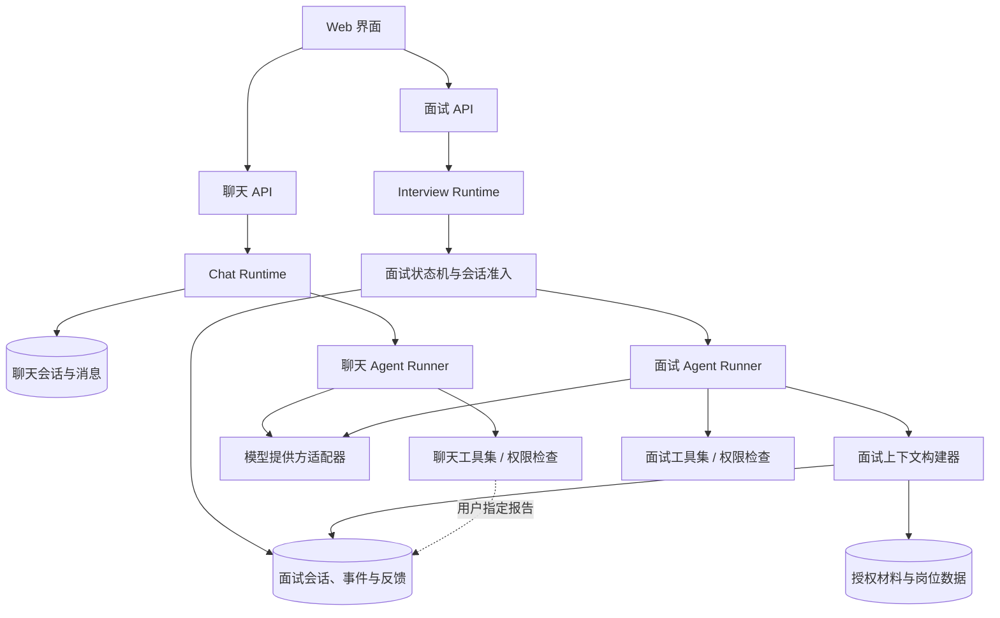

# 求职场景双线 Agent 项目定义

> 文档状态：项目定义与实现状态对照
> 编写日期：2026-10-30
> 目标用户：求职者
> 依据：用户讨论、本地 nanobot / Akashic Agent / Pi 源码结构与核心实现。下文的目标架构与当前实现分别说明。

## 当前实现状态

截至 2026-10-31，实际代码位于 `career_agent/`，采用单个 FastAPI 应用、SQLite、原生 HTML/CSS/JavaScript 和两份 Markdown Skill。下文第 14 节是目标目录归属示意，不是目前的文件树，也不要求为了目录一致而拆分已运行的代码。

当前已经实现：双入口独立会话与模型上下文、模型/只读工具循环、面试材料授权、经历确认、逐题回答、可配置 1–10 题、回答更正、跳题、暂停恢复、主动结束、逐题报告与单题复练。跳题记录不产生回答反馈或证据。长面试的模型输入保留各已完成题目的简短反馈与回答证据，供全场总结参考，不裁切 SQLite 原始记录。聊天运行中可提交后续输入，失败后可重试最后一条未回复消息，用户可为每个聊天会话保存固定备注；聊天页可选择材料或已有反馈的报告，将 ID 加入消息草稿，发送后才授权本轮读取。材料和经历的编辑产生新记录，旧面试保留原版本。前端支持 `.txt`、`.md`（UTF-8、GB18030）、`.docx` 与文本型 `.pdf` 导入、编辑、报告、复练对照、Markdown 导出和 SQLite 业务数据快照下载；应用启动、每小时及正常退出时更新最近一次业务快照，并保留最近 7 份每日快照；停服后可用本地命令校验并恢复业务快照。可选账户模式提供注册登录和按账户独立的数据存储。

聊天与面试会话现在可单独命名，列表可按名称、面试目标、对话内容或 ID 查找；面试也可按题目、回答和反馈查找。搜索限定当前入口与当前账户的数据文件，最多输入 100 字，列表响应不返回消息正文或聊天固定备注。名称是展示元数据，不进入模型提示，也不改变运行状态或会话版本；旧数据库启动时补齐空名称字段。

页面导航将聊天入口标为“新对话”、面试入口标为“AI 面试”。点击“新对话”打开空白草稿，已保存的对话可从侧栏历史恢复；窄屏下历史区可展开。新对话主区把常用问题作为可编辑草稿，并把材料引用、固定备注放在输入区旁按需展开。选择常用问题不会自动发送或创建会话；发送消息后仍按原有授权与存储流程处理。AI 面试主内容维持现有准备、逐题练习与报告布局。

界面配色约束为黑、白、灰及其灰阶和透明度；按钮、会话选中态、表单焦点、错误提示和遮罩均遵守该约束，状态同时由文字或边框表达。

当前仍未实现：面向公网的完整账户安全控制、密码重置、扫描版 PDF 的 OCR、自动提炼的长会话记忆、语音与实时转写、多渠道、日程和外部搜索。聊天会话已有用户维护的固定备注，超出最近消息窗口后仍会进入聊天上下文，不进入面试上下文。真实模型面试效果没有完成验证；演示 Provider 的固定反馈不能作为质量结论。

模型运行现按会话版本原子认领，重复请求不会再次调用模型；模型循环有 120 秒时限、4 轮和 8 次工具调用上限。兼容 Provider 的每次输出请求上限为 2048 token；运行事件记录提示词版本与端点实际返回的 token 用量。累计 token 阈值只能在端点提供用量时阻止后续循环，尚不能保证货币费用上限。工具参数在执行前验证；面试结构化结果还校验首题、进行中与结束阶段的字段语义和长度。模型错误响应使用稳定错误码，不展示上游原始报错。

聊天和面试页面现在可展开当前会话最近 30 条模型与工具运行记录；页面显示已保存的状态、用量等元数据和工具结果，不包含材料或回答正文。完整运行事件仍保存在对应会话的 SQLite 业务库中。

本地启动可使用 `python -m career_agent`，默认只监听 `127.0.0.1:8000`。兼容模型配置缺少模型名或 URL 格式不正确时，页面会提示并禁用模型运行入口。兼容接口返回 `finish_reason=length` 时，本轮拒绝提交截断结果及执行其中的工具调用；用户原始输入保留，用量仍进入运行事件。

## 1. 项目概述

本项目为求职者提供两个独立入口：

1. **AI 聊天助手**：支持自然聊天，讨论岗位和求职准备，整理用户确认的经历，解释面试反馈，并引导用户进行复练。它可以逐步扩展为更完整的个人助手。
2. **面试 Agent**：负责正式的模拟面试，按题目提问，理解用户的回答并进行追问，保存完整答题记录，给出有依据的反馈并组织复练。

产品采用 **Workflow + Agent**。Workflow 负责可以明确规定的流程、状态和持久记录；Agent 在授权范围内根据用户输入决定检索内容、选择追问方向或组织聊天答复。两个入口可以共用模型提供方、工具执行框架、日志设施和基础数据服务，但使用各自的会话及上下文。

**已确定的核心隔离规则：面试 Agent 的会话记忆和模型上下文不包含聊天助手中的消息或记忆。** 聊天助手可以在用户提出要求时读取指定面试反馈并进行讨论；这不意味着把聊天历史写入面试会话。

## 2. 项目目标

- 为求职者提供连续的聊天准备与正式模拟面试体验。
- 让面试 Agent 能根据当题回答自适应追问，而非只运行固定题库。
- 使用户的原始回答、材料来源、模型推断和评价反馈能够区分并追溯。
- 支持暂停、恢复、后续输入、工具调用、模型失败恢复和跨轮复练。
- 为聊天助手和面试 Agent 设置清楚的会话隔离与工具权限。
- 后续可扩展语音与实时转写、多渠道接入、日程、外部搜索和更多模型 Provider。

当前先定义系统边界和业务职责。两条入口各自的用户价值会在产品使用后评估，不作为当前架构成立的前提。

## 3. 用户与使用场景

### 3.1 主要用户

准备求职面试的个人用户。产品面向求职者的准备和练习，不承担企业招聘筛选、候选人排名或真实面试代答职责。

### 3.2 聊天助手场景

- 讨论目标岗位、JD 和面试安排。
- 通过聊天整理项目经历、识别表达缺口，并让用户确认事实。
- 回顾用户指定的面试反馈，解释反馈依据并讨论如何准备。
- 根据准备情况引导进入独立的模拟面试会话。
- 逐步扩展其他个人助手能力；具体能力由后续需求决定。

### 3.3 面试 Agent 场景

- 根据目标岗位、面试方向和用户授权的材料发起一轮面试。
- 一次提出一个问题，等待用户作答。
- 根据回答追问个人贡献、方法、依据、权衡和结果。
- 在本轮结束后生成引用回答或材料证据的反馈。
- 生成不同的新题，帮助用户练习并检查能力迁移。

## 4. 两条入口的关系

```text
同一用户与产品
  ├─ AI 聊天助手
  │    ├─ 独立聊天会话与上下文
  │    ├─ 岗位讨论、经历整理、反馈解释
  │    └─ 可逐步增加用户授权的个人助手工具
  │
  └─ 面试 Agent
       ├─ 独立面试会话与上下文
       ├─ 面试状态机、逐题作答与动态追问
       └─ 反馈、复练目标和完整面试记录

  共用的基础能力：模型提供方适配、工具执行框架、身份鉴权、运行日志
```

两条入口使用不同的会话 ID、消息记录和上下文构造过程。系统不从聊天消息或聊天记忆构建面试 Agent 的提示词。聊天助手要讨论面试报告时，由用户指定报告或轮次，再读取对应的面试产物。

岗位材料属于用户管理的数据资源，不是聊天记忆。两条入口是否能读取某份材料，由资源授权决定；材料不会因为存放在同一账户中就自动进入每次模型上下文。

## 5. 核心业务闭环

### 5.1 面试准备与复练闭环

```text
岗位目标与材料
  → 确认经历主张
  → 开始一轮模拟面试
  → 提问、回答、动态追问
  → 保存完整记录
  → 生成有依据的反馈
  → 选择下一练习目标
  → 用新问题复练
```

### 5.2 典型示例

用户说：“我将接口延迟降低了 40%。”面试 Agent 可以查询当前授权的项目材料，并追问：

- 40% 是和什么基线比较？
- 你负责的具体改动是什么？
- 如何测量延迟，如何排除流量变化的影响？
- 这项优化有哪些成本或副作用？

如果材料没有记录相应依据，系统应标记为未核实，不能把模型推断写成用户经历。面试后，反馈指出回答已经包含的证据和仍需补充的事实；复练题应换一种问法，而不是要求用户复述模型范文。

## 6. Workflow 与 Agent 的职责

| 事项 | 负责者 | 说明 |
|---|---|---|
| 创建会话、选择岗位目标 | Workflow | 生成稳定的会话与资源关联 |
| 保存聊天消息或面试回答 | Workflow / 存储层 | 先持久化，再调用模型 |
| 决定面试是否正在作答、暂停或结束 | 面试 Workflow | 维护合法状态转换 |
| 根据回答选择追问方向 | 面试 Agent | 输出结构化的下一步建议 |
| 读取岗位、材料或指定报告 | 授权工具层 | 在执行时核对会话和资源权限 |
| 组织聊天回答 | 聊天 Agent | 使用自己的聊天历史和授权资源 |
| 写入反馈、推进题号 | Workflow | 校验 Agent 结果后提交状态 |

Agent 不拥有任意数据库写入权限。模型可建议“追问”或“结束本题”，但只有 Workflow 在状态和权限校验通过后才推进面试。

## 7. 系统架构



### 7.1 前端

- 聊天区：聊天历史、材料讨论、反馈解释、工具授权提示。
- 面试区：当前题目、回答输入、追问轨迹、暂停/恢复和结束操作。
- 目标与材料页：岗位目标、材料来源、用户确认的经历主张。
- 历史页：按入口分别查看聊天会话或面试会话。

### 7.2 API 与运行时

聊天 API 和面试 API 分别负责各自的会话操作、事件和状态。运行时可以共享用户身份、模型连接与基础工具机制，但每次执行必须携带 `agent_type`、`session_id`、用户身份、工具权限范围及资源范围。

### 7.3 Agent Runner

两个入口可共用底层 Agent 执行库，但使用独立配置、系统提示、工具清单和上下文构建器。运行闭环为：

```text
构建本次上下文
  → 请求模型
  → 校验并执行获授权工具
  → 把工具结果交回模型
  → 解析结构化结果
  → 由对应 Workflow 校验并提交
```

模型提供方适配器处理流式输出、工具调用协议、取消与错误映射。一次运行设最大轮次、工具调用数、超时及上下文预算。

## 8. 会话、上下文与记忆

### 8.1 会话隔离规则

- 聊天消息只写入聊天会话；面试消息和事件只写入面试会话。
- 每个模型请求从所属会话和本次授权资源构建上下文。
- 面试 Agent 的上下文查询明确排除聊天消息、聊天摘要和聊天记忆。
- 聊天助手读取面试报告时，使用用户指定的报告 ID 或轮次；读取结果用于当前讨论，不拼接两个会话的原始消息。
- 跨线的经历主张通过“用户确认”转成业务材料记录，不把聊天原文整体复制到面试历史。

### 8.2 完整记录与模型上下文

完整会话记录保存事件事实；模型上下文是每次推理时构造的有限视图。裁切、摘要和检索只影响模型输入，不覆盖原始消息。

面试记录至少包含问题、用户原始回答、追问、跳过/暂停/恢复事件、工具读取的来源、Agent 决定和最终反馈。聊天记录保存独立的用户与助手消息及工具活动。

### 8.3 个人记忆与材料

如需保存偏好、长期准备目标等记忆，应按入口分别管理。面试 Agent 的面试目标、历史反馈和复练目标可构成其领域状态；聊天助手的个人记忆不进入面试 Agent。简历、JD、项目材料以独立资源保存，通过资源授权提供给某次会话。

## 9. 面试状态机与故障恢复

面试会话建议采用以下状态：

```text
准备中 → 进行中 ↔ 已暂停 → 已完成
                    └────→ 已取消
```

单题可采用：`已提问 → 等待回答 → 评估回答 → 追问 / 完成本题`。Workflow 管理状态转换，Agent 只提出下一步建议。

- 用户回答先保存，再发起模型请求。
- 暂停时保存当前题与已提交回答；恢复从此状态继续。
- 用户中途补充或更正时，将其关联到对应题目并生成新事件。
- 每个模型运行绑定 `session_id`、题目 ID 和状态版本。旧运行迟到后若版本已变化，结果不得推进新题。
- 模型或工具失败时保留用户回答，允许从当前题重试。
- 取消与暂停语义不同：取消结束本轮；暂停允许恢复。

聊天助手同样按聊天会话维护运行状态。两个入口可同时工作，但各自队列、取消信号和会话锁互不影响。

## 10. 并发与工具权限

### 10.1 并发策略

- 同一面试会话按题目顺序串行执行。
- 不同用户或不同面试会话可以并发。
- 同一聊天会话的消息顺序保持稳定；不同聊天会话可以并发。
- 独立只读查询可以并行；保存回答、推进题目和提交反馈按会话串行。
- 聊天与面试两条运行链路可以并行，彼此不读取对方的运行中消息。

### 10.2 工具授权

权限由工具执行层强制校验，按以下维度确定是否允许调用：

- 调用工具的 Agent 类型：聊天助手或面试 Agent。
- 当前用户与当前会话身份。
- 资源所有者、资源 ID 与访问范围。
- 操作类型：读取、写入、发送或删除。
- 是否需要用户确认。

首版面试工具以只读材料查询和结构化 Agent 决定为主。聊天助手可以有独立工具集；后续新增文件、日程、外部消息等能力时，逐项设定执行权限与确认规则。提示词约束不能替代执行层检查。

## 11. 材料与事实模型

建议的数据对象如下：

| 对象 | 内容 | 作用 |
|---|---|---|
| `User` | 账户和授权主体 | 绑定会话、材料和工具权限 |
| `Goal` | 公司、岗位、JD 版本和目标 | 组织面试准备 |
| `SourceMaterial` | 简历、JD、项目材料及来源 | 用户可查看、更新和撤回 |
| `Claim` | 经历主张、材料位置、确认状态 | 区分材料事实与推断 |
| `AssistantSession` | 聊天会话元数据 | 独立维持聊天轮次 |
| `AssistantMessage` | 聊天用户/助手消息与工具事件 | 形成聊天历史 |
| `InterviewSession` | 面试模式、状态、目标、版本 | 管理一轮面试 |
| `InterviewEvent` | 问题、回答、追问、控制事件 | 保留完整面试轨迹 |
| `Assessment` | 维度反馈、证据引用与不确定项 | 支持回顾和复练 |
| `PracticeTarget` | 要练习的能力与来源反馈 | 生成下一轮目标 |
| `ToolGrant` | Agent、工具、资源和操作授权 | 执行前验证权限 |
| `ModelRun` | 模型、提示版本、工具轨迹、结果状态 | 调试、追踪和质量评估 |

反馈与复练目标是面试产物，不等于个人经历事实。模型提取的经历主张在用户确认前应标记为待确认。

## 12. Markdown Skill 与提示规则

Skill 保存可复用的工作说明，不保存会话事实。

- 聊天助手 Skill：岗位讨论、经历整理、反馈讲解等聊天行为。
- 面试 Agent Skill：项目经历追问、行为面试、技术面试等面试行为。
- 每次运行只加载所属入口的 Skill，避免面试 Agent 使用聊天助手指令或反向混用。
- 评价维度、面试状态、用户事实和工具权限属于结构化配置或业务数据，不由 Markdown 自行决定。
- Skill 更新后保留版本标识，便于追溯某次模型行为使用的规则。

## 13. 模型提供方与可观测性

模型通过统一适配器接入，提供模型选择、工具调用、流式输出、中断、错误处理与用量记录。聊天和面试可以使用同一模型，也可独立配置；模型变化不应改变会话隔离或工具授权。

每个模型运行至少记录：入口类型、会话 ID、模型和提示版本、上下文来源标识、工具调用名称、耗时、终态和错误。当前运行事件记录模型实际返回的 token 用量与覆盖状态，不保存完整模型上下文；未返回用量的端点标为不可用。敏感的完整上下文是否长期保存需单独配置；默认日志应避免无必要复制简历与回答正文。

## 14. 建议的项目目录

```text
Nico-agent/
├─ backend/
│  ├─ app.py                         # 服务组装入口
│  ├─ api/
│  │  ├─ assistant.py                # 聊天会话 API
│  │  ├─ interview.py                # 面试会话 API
│  │  ├─ goals.py                    # 岗位目标 API
│  │  └─ materials.py                # 材料与经历主张 API
│  ├─ assistant/
│  │  ├─ runtime.py                  # 聊天会话运行时
│  │  ├─ context.py                  # 聊天上下文
│  │  └─ tools.py                    # 聊天工具与权限声明
│  ├─ interview/
│  │  ├─ runtime.py                  # 面试运行时
│  │  ├─ state_machine.py            # 面试与题目状态机
│  │  ├─ context.py                  # 不读取聊天消息的上下文
│  │  ├─ followup.py                 # 追问决策接口
│  │  ├─ assessment.py               # 反馈组织
│  │  └─ practice.py                 # 复练目标和新题
│  ├─ agent_runtime/
│  │  ├─ runner.py                   # 模型/工具循环
│  │  ├─ providers.py                # 模型提供方适配
│  │  ├─ tool_registry.py            # 工具注册与权限执行
│  │  └─ events.py                   # 流式、取消和运行事件
│  ├─ evidence/
│  │  ├─ ingestion.py                # 材料解析
│  │  ├─ claims.py                   # 经历主张及确认状态
│  │  └─ retrieval.py                # 按授权检索材料
│  └─ storage/
│     ├─ assistant_sessions.py       # 聊天会话持久化
│     ├─ interview_sessions.py       # 面试会话持久化
│     ├─ materials.py                # 用户材料
│     └─ database.py                 # 数据库连接与事务
├─ frontend/
│  └─ src/
│     ├─ chat/                       # 聊天助手界面
│     ├─ interview/                  # 模拟面试界面
│     ├─ goals/                      # 岗位目标和材料
│     └─ history/                    # 分入口历史和报告
├─ skills/
│  ├─ assistant/                    # 聊天助手 Skills
│  └─ interview/                    # 面试 Agent Skills
├─ tests/
│  ├─ assistant/                    # 聊天会话与工具授权
│  ├─ interview/                    # 面试状态、上下文和追问
│  └─ scenarios/                    # 双入口隔离与完整流程
├─ migrations/                      # 数据结构迁移
├─ docs/                            # 产品定义、协议与评估材料
└─ README.md
```

目录代表代码归属，不要求一次创建全部文件。系统从一个后端应用与独立模块开始；只有运行规模、部署或团队边界确有需要时，再拆服务或增加消息总线。

## 15. 从三个项目借鉴的设计

| 参考项目 | 借鉴点 | 在本项目中的用法 |
|---|---|---|
| nanobot | 消息循环、上下文构建、Skills、工具注册、会话调度、记忆和聊天渠道适配 | 用于理解聊天助手与工具循环；只选当前需要的渠道和记忆能力 |
| Akashic Agent | 独立 turn 控制面、会话准入、持久 turn 状态、事件提交与运行生命周期 | 用于面试 Workflow 的会话状态和恢复设计；暂不复制复杂插件 generation 和主动运行栈 |
| Pi | Agent Loop、事件流、工具顺序/并发执行、会话追加记录、Provider 和扩展接口 | 用于底层 Agent Runner；面试的业务状态和双线会话仍由本项目控制 |

参考源码入口：

- nanobot：`E:\nanobot\nanobot\agent\loop.py`、`runner.py`、`context.py`、`memory.py`、`channels\manager.py`、`session\manager.py`。
- Akashic Agent：`E:\Akashic-agent\akashic-agent\bootstrap\app.py`、`bootstrap\passive_worker.py`、`agent\control\runtime.py`、`agent\core\passive_turn.py`、`session\store.py`。
- Pi：`E:\Agent\Pi-agent\pi\packages\agent\src\agent-loop.ts`、`agent.ts`、`packages\coding-agent\src\core\session-manager.ts`、`core\extensions\loader.ts`。

对照基于本地快照：nanobot `9ecd25bc`、Akashic Agent `53231756`、Pi `0d23d53`。这些代码提供架构参考，不意味着复制三个项目的全部功能或实现。

## 16. 分阶段实现

### 阶段一：双入口骨架

实现用户身份、聊天会话、面试会话和基础模型调用。确保各自有独立会话 ID、历史存储和上下文构建路径。

### 阶段二：面试 Workflow 与 Agent

实现岗位目标、材料确认、逐题状态机、Agent 动态追问、面试记录和反馈。先以文本交互为主。

### 阶段三：聊天助手能力

实现连续聊天、岗位讨论、经历整理、指定反馈解释和复练引导。按独立工具权限逐步提供需要的工具。

### 阶段四：持续能力扩展

后续可加入语音输入与输出、实时转写、多聊天渠道、日程工具、外部搜索和更多模型 Provider。接入时复用双线运行时，但保持会话 ID、历史、上下文和工具授权边界。

| 扩展能力 | 接入位置 | 必须保持的约束 |
|---|---|---|
| 语音与实时转写 | 音频输入/输出适配器，生成带时间与说话人信息的转写事件 | 原始音频与转写按会话归属；面试 Agent 仍不读取聊天内容 |
| 多渠道 | Channel Adapter 将平台事件转换为明确的聊天或面试命令 | 路由到正确入口和会话；不能因渠道相同而合并历史 |
| 日程 | 聊天工具集中的独立日程工具 | 按用户和操作授权；创建、修改或取消事件按配置要求确认 |
| 外部搜索 | 独立搜索工具，返回结果、来源和检索时间 | 搜索内容作为外部材料，不自动写成用户经历事实 |
| 更多模型 Provider | 统一 Provider Adapter 的新实现 | 保持工具调用、流式事件、取消和错误语义，并分别验证两条运行线 |

这些扩展能力现在只需在接口和模块归属上留出清晰位置，具体接入顺序由后续需求决定。

## 17. 验收要求

### 技术验收

- 聊天会话与面试会话分别落库，历史查询按入口过滤。
- 面试 Agent 的模型输入不包含聊天消息、聊天摘要或聊天记忆。
- 用户指定某份面试反馈后，聊天助手能够读取并解释相应产物。
- 面试 Agent 不能调用未授予它的工具；越权调用在执行层拒绝。
- 同一面试会话的题目顺序稳定；旧的模型运行不能提交到已变化的题目状态。
- 模型/工具失败后，已保存的用户回答不会丢失。

### 产品效果评估

两条入口的用户问题解决效果留待后续观察。面试线可评估追问针对性、反馈事实依据和新题复练表现；聊天线可根据实际使用任务评估。当前不以效果评估结论作为双线架构的前置条件。

## 18. 当前决策与未定事项

### 当前决策

- 产品包含聊天助手和面试 Agent 两个入口。
- 两条入口分别保存会话。
- 面试 Agent 的会话记忆与上下文排除聊天内容。
- 工具权限按 Agent 身份设置，并在执行层校验。
- 聊天助手可以讨论岗位、整理经历、解释反馈和引导复练。
- 面试 Agent 负责逐题模拟、动态追问、持久记录和复练反馈。

### 留待后续

- 聊天助手还要支持哪些个人助手能力。
- 首批面试岗位和面试类型。
- 语音、实时转写、多渠道、日程、外部搜索和更多 Provider 的具体接入顺序与实现范围。
- 是否加入代码执行及其沙箱方式。
- 两条入口分别解决用户问题的实际效果。

未定事项不阻止双线会话、上下文与工具权限的基础架构定义。
